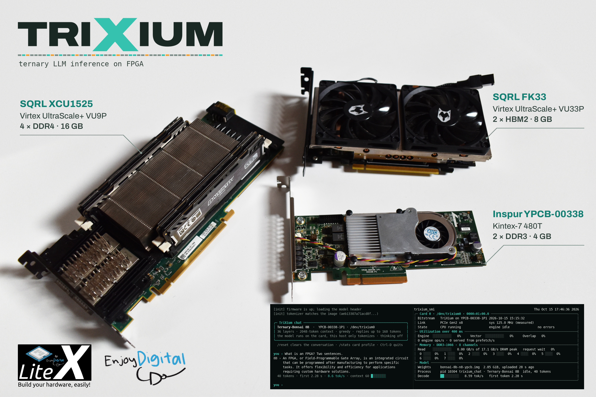
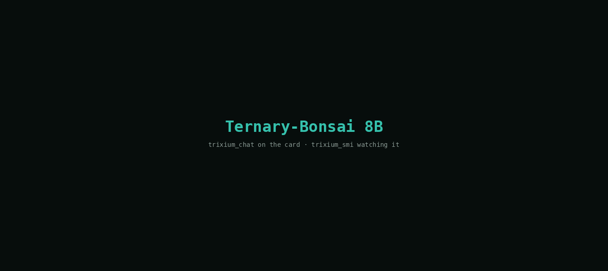
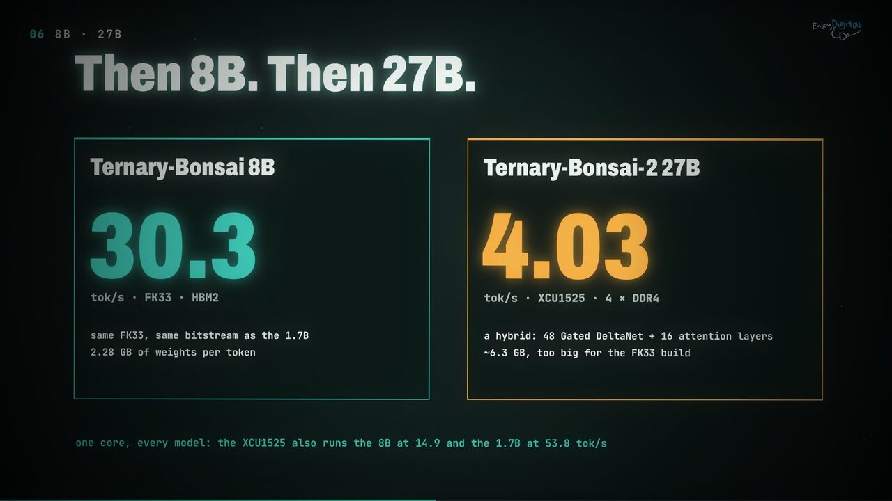
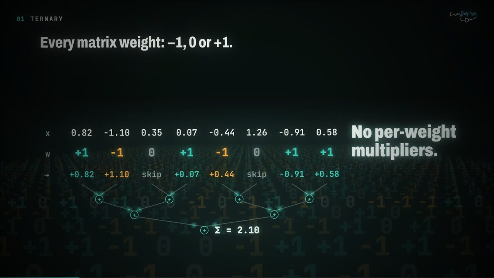
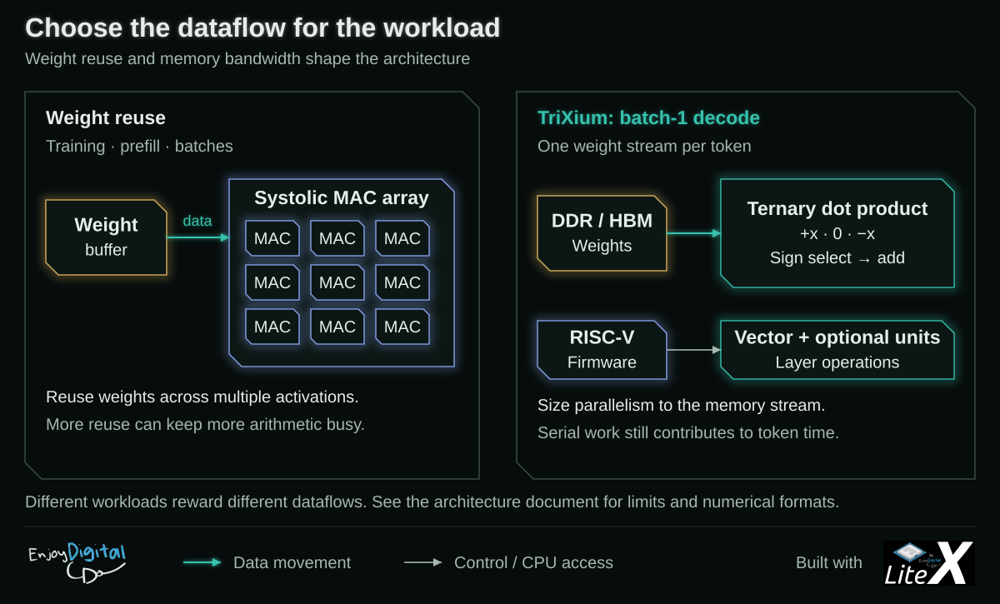
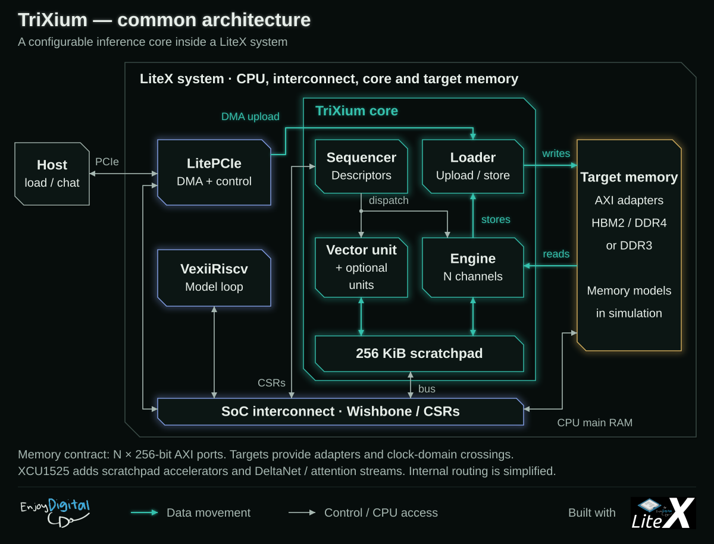
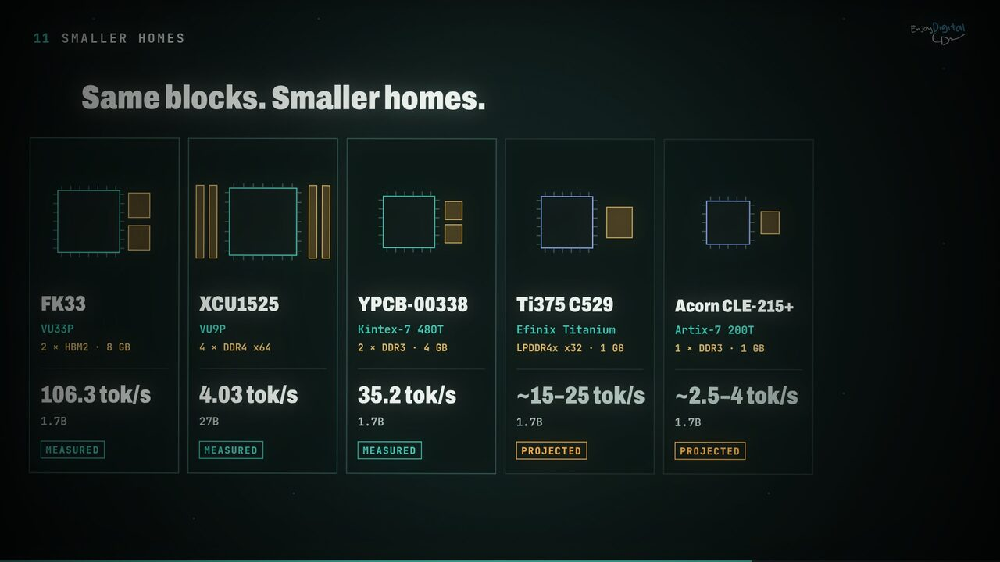
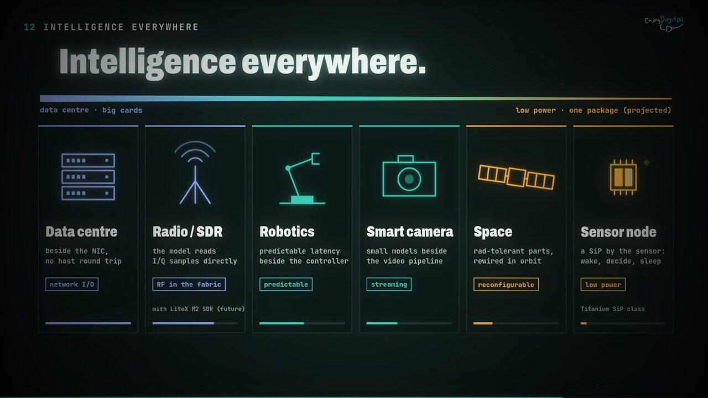
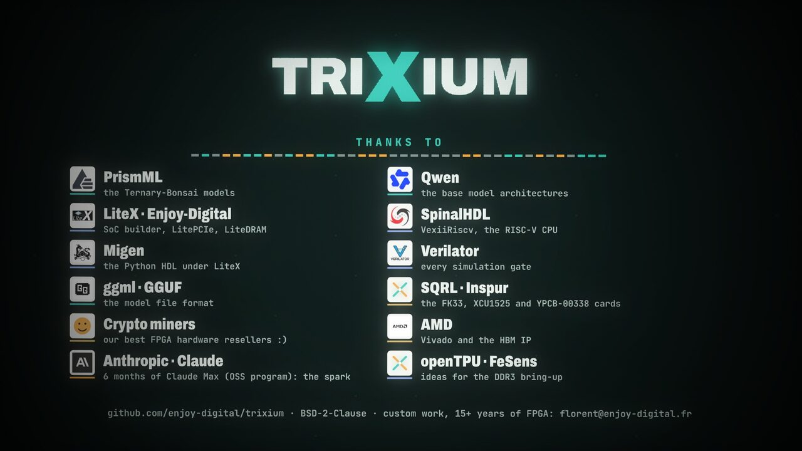

```
                                    ______    _ _  ___
                                   /_  __/___(_) |/_(_)_ ____ _
                                    / / / __/ />  </ / // /  ' \
                                   /_/ /_/ /_/_/|_/_/\_,_/_/_/_/
                       Ternary LLMs on FPGA, open source end to end with LiteX.
                                 Copyright (c) 2026 Enjoy-Digital.
```

# TriXium

[](doc/images/trixium.mp4)

**[Watch the video](doc/images/trixium.mp4)** (2:11, 720p, sound on; made from code, see
[`doc/illustration/`](doc/illustration/)).

**TriXium** runs ternary LLMs on FPGA: PrismML's **Bonsai** models decoded entirely on the
card, open source end to end with LiteX. Ternary-Bonsai 1.7B and 8B (Qwen3) and
Ternary-Bonsai-2 27B, 4B and 2B (Qwen3.5, a hybrid of DeltaNet and attention layers) run on second-hand
FPGA accelerator cards; the host only tokenizes. Every matrix weight is -1, 0 or +1 (plus one
fp16 scale shared by each group of 128), so the "matrix multiply" is *add, skip or subtract*
across 128 activations, then a single multiply by the group's scale. The hardware is built
around the one thing that really limits single-user chat: how many bytes per token the memory
can deliver.

It is open source all the way down: LiteX, LitePCIe, LiteDRAM and VexiiRiscv provide the SoC,
CPU, PCIe/DMA and DDR controllers (no vendor IP), and the inference core and firmware on top
were developed with AI (a Claude agent guided by Enjoy-Digital).

🇫🇷 **Made in France.** TriXium is built by Enjoy-Digital, a small French company, on LiteX,
LiteDRAM and LitePCIe, which also come from Enjoy-Digital and are used by other projects
(openTPU, for one, currently seems to test both LiteDRAM and AMD's MIG for its DDR3, with
LiteDRAM giving interesting results).



*Recorded as is: `trixium_chat` (left) talks to Ternary-Bonsai 8B, then 1.7B, on an Inspur
YPCB-00338 (Kintex-7, two DDR3-1066 channels); `trixium_smi -l` (right) watches the engine, the
eight memory channels and the reply's rate.*

## Try it

With a card and its host in `~/.config/trixium/boards.ini`
([`doc/getting-started.md`](doc/getting-started.md) has the full story):

```sh
trixium deploy --board ypcb --model 1p7b     # bitstream, firmware, weights, tokens, bench
trixium chat                                 # on the card's host: talk to it
trixium smi -l 1                             # and watch it work
```

No card? The whole SoC (CPU, firmware, core, memory controllers) runs in Verilator:

```sh
trixium models --tiny && ./trixium_sim.py --build && ./trixium_sim.py --run
```

## Results

[](doc/images/video-models.jpg)

Batch-1 decode on the card, first tokens checked against the reference:

| board | memory | model | tok/s |
| --- | --- | --- | ---: |
| SQRL **XCU1525** (XCVU9P) | 4x DDR4 x64 | Ternary-Bonsai-2 **27B** | **4.03** |
| | | Ternary-Bonsai 8B | 14.9 |
| | | Ternary-Bonsai 1.7B | 53.8 |
| SQRL **FK33** (XCVU33P) | 8 GB HBM2, 16 channels | Ternary-Bonsai 8B | 30.3 |
| | | Ternary-Bonsai 1.7B | **106.3** |
| Inspur **YPCB-00338** (XC7K480T) | 2x DDR3-1066 x64 | Ternary-Bonsai 8B | 8.11 |
| | | Ternary-Bonsai 1.7B | **35.2** |
| | 2x DDR3-933 x64 (hybrid build) | Ternary-Bonsai-2 4B | 5.98 |
| | | Ternary-Bonsai-2 2B | 13.20 |

Against CPUs and GPUs (PrismML's published Apple M4 Pro figures, our RTX 3080 run), per GB/s of
memory bandwidth, and energy-per-token estimates: [`doc/results.md`](doc/results.md). The short
version: a 320 W GPU with 44x the bandwidth is much faster, but on the 8B the YPCB-00338 gets
0.47 tok/s out of each GB/s, against 0.26 for the RTX 3080 and 0.28 for the M4 Pro's GPU.

### Second-hand hardware

None of these cards was bought new for the job. The FK33 and the XCU1525 are retired
cryptocurrency-mining accelerators; the YPCB-00338 is a retired Inspur data-centre card. They
now sell second-hand for the price of a nice dinner (the Kintex-7 card) to that of a mid-range
GPU (the VU9P):

| card | FPGA | memory | first life | second-hand price |
| --- | --- | --- | --- | ---: |
| Inspur **YPCB-00338** (also listed as YZCA-00338) | Kintex-7 XC7K480T | 2x DDR3 x72, 4 GB | data-centre accelerator | ~$55-140 |
| SQRL **FK33** (Forest Kitten 33) | Virtex UltraScale+ VU33P | 8 GB HBM2 | crypto mining | ~$250-350 |
| SQRL **XCU1525** (sold as BCU1525, a VCU1525 clone) | Virtex UltraScale+ VU9P | 4x DDR4 x72 (DIMMs) | crypto mining | ~$400-1,000 |

Asking prices on eBay and AliExpress listings in October 2026 (the XCU1525's depends on the
memory and cooling it comes with); they move, so check before buying. Which makes the
YPCB-00338 a cheap way to run an 8B language model entirely on an FPGA: a card that costs less
than the motherboard it plugs into, decoding at 8 tok/s.

### Known issues

The simulation is bit-exact against the Python mirror (87 FP32 checkpoints through the full
SoC). On the cards, long generations are **not always identical from one run to the next** on
two boards, and we would rather say so than let a demo say otherwise:

- **YPCB-00338:** DDR3 read errors when every channel streams at full rate, on one of the two
  controllers. In progress on the development branch: SECDED ECC on each channel's spare ninth
  byte lane (runs on the card), and a DDR3-933 build that cuts the errors about 400x.
- **XCU1525:** on some boots, one DDR4 controller trains marginally and corrupts writes. Fix: a
  boot-time deep memory test that retrains the controller until it passes, on the development
  branch.

Details: [`doc/boards.md`](doc/boards.md#known-issues).

## Why ternary, and why not a TPU

[](doc/images/video-ternary.jpg)

A **TPU** (Google's, or [openTPU](https://github.com/FeSens/openTPU) on FPGA) is a **systolic
array**: a grid of multiply-accumulate cells that loads a block of weights once and reuses it
against many activations. Training, prompt processing and batched serving keep the grid busy,
and an ISA plus a compiler map almost any model onto it.

**One user generating one token at a time** (batch-1 decode, the chat case) has no reuse:
every weight is read once per token and used once. The speed limit is then
**bytes per weight x memory bandwidth**, and most of a big array would just wait for memory,
politely. TriXium is built for that case: ternary weights need no multipliers, so the engine is
**adder trees sized to the bytes the memory delivers**, and the rest of a layer (norms,
attention, SiLU, the 27B's DeltaNet recurrence) runs on a **RISC-V running C**, a microcoded
vector unit and fixed-function units added only where profiling showed they pay.

[](doc/images/why-not-tpu.svg)

| | TPU-style (systolic array) | TriXium (streaming ternary) |
| --- | --- | --- |
| best at | training, prefill, batched serving | batch-1 decode |
| compute | 2D grid of multipliers (int8 / 4-bit / bf16) | ✅ **adder trees, sign-select instead of multiply** |
| bytes per weight | 4-16 bits (4-bit, int8, bf16) | ✅ **1.7-2.1 bits** |
| multipliers (DSP blocks) | one per MAC: the array *is* multipliers | ✅ **one per 128 weights** |
| models | ✅ **any, quantized; one bitstream, a compiler** | natively ternary models (PrismML Bonsai) |
| new layer types | ✅ **software** | firmware, sometimes gateware, then a build |

✅ the better side of each row (the first row is two different jobs, not a contest).

**Same card, two small open projects.** openTPU and TriXium both run on the YPCB-00338, both
are open, and both are, give or take an AI agent, one person's work. They make opposite
trade-offs: openTPU runs any off-the-shelf model through an ISA and a compiler and keeps its DRAM
busier; TriXium reads ~3.5x fewer bytes per token with natively ternary models, which comes out
at 2.5-2.8x the decode rate per parameter (different models, so a speed comparison, not a
quality one). The numbers, and the other FPGA LLM designs:
[`doc/related-work.md`](doc/related-work.md#opentpu-on-the-same-card).

**Specialised at build time, like a GPU kernel.** On an FPGA, flexibility is paid in logic: a
generic architecture spends LUTs, routing and timing margin on muxes, crossbars and
configurable datapaths a given model never uses (SDR folks know the feeling: RFNoC is
wonderfully composable, but a good share of the fabric goes to the interconnect between the
blocks). TriXium fixes the topology at build time - channels, lane widths, weight format, which
units exist - like a hand-written kernel compiled for one model. The price is a few hours of
Vivado per model family; the return is every token, for as long as the card runs: smaller
FPGAs, models and hardware co-designed, no idle multiplier array toggling for nothing. The
full argument, with its costs (batch-1 only, ternary models only, a CPU in the loop):
[`doc/architecture.md`](doc/architecture.md).

## Inside

[](doc/images/architecture.svg)

A target supplies the clocks, the CPU, PCIe and the memory system, and instantiates one
TriXium core with three standard interfaces: `memory_ports` (AXI), `bus` (wishbone) and
`upload` (stream). The same core runs on the FK33's HBM2, the XCU1525's four DDR4 controllers
and the YPCB's two DDR3 controllers ([`doc/boards.md`](doc/boards.md)). Three boards are
tested here, but any board with PCIe and enough memory that LiteX-Boards already supports should
be an easy port: a target file of a few hundred lines, the core unchanged. Every change is
simulated bit-exact first, then measured on the card, then kept or reverted: how we work and
what it taught, in [`doc/method.md`](doc/method.md); the dates, in [`doc/timeline.md`](doc/timeline.md).

## Where this is going

Fifteen years ago the question behind LiteX was "can we build complex SoCs in FPGAs with open,
readable, efficient tools?". We think the answer was yes. The next question is the same one
with a new workload: **can an FPGA SoC think?** TriXium is a start, not a destination:

- **Make it boring to be correct**: ECC and stronger memory checks so long generations are
  identical on every card, with the bit-exact simulation as the contract.
- **Faster tokens: send LiteDRAM patches.** TriXium is memory-bound, so the best way to make it
  faster - and every other project on LiteDRAM with it - is to make LiteDRAM faster. Patches
  welcome, there. Then hide the per-token work under the weight streams
  ([`doc/performance-next-steps.md`](doc/performance-next-steps.md)).
- **An open toolchain**: openXC7 (the open-source flow for Xilinx 7-series) is the natural next
  step, and the YPCB-00338's Kintex-7 the natural first target. Not working yet; on the list.
- **FPGAs, not ASICs**: no ASIC plan. Smaller FPGAs and FPGA Systems-in-Package next, with the
  code kept vendor-agnostic and fast, the LiteX way (only AMD/Xilinx is measured so far).
- **Upstream the building blocks**, so "add a language model to my SoC" eventually becomes an
  option in a target file rather than a research project.

[](doc/images/video-smaller-homes.jpg)

**Same blocks, smaller homes.** Batch-1 decode is set by the memory, so a smaller home is easy
to project: tok/s ~ bandwidth x ~78 % / bytes per token (0.38 GB for the 1.7B with 5-trit codes,
the YPCB-00338's measured ratio). Projections, labelled as such, with assumed board powers:

| home | FPGA | memory | model | tok/s | power (assumed) | mWh/token |
| --- | --- | --- | --- | ---: | ---: | ---: |
| FK33 | VU33P | 2x HBM2, 8 GB | 1.7B | 106.3 (measured) | 27 W FPGA (Vivado) | 0.07 (est.) |
| XCU1525 | VU9P | 4x DDR4 | 27B | 4.03 (measured) | 20 W FPGA (Vivado) | 1.4 (est.) |
| Efinix Ti375 C529 | Titanium Ti375 | LPDDR4x x32, 1 GB | 1.7B | ~15-25 (projected) | 3-5 W | ~0.03-0.09 |
| Acorn CLE-215+ | Artix-7 200T | 1x DDR3, 1 GB | 1.7B | ~2.5-4 (projected) | 3-5 W | ~0.2-0.6 |
| Titanium SiP | Ti60 / Ti125 | 32-64 MiB HyperRAM in the package | tiny (15M+) | ~10-30 (projected) | 0.3-1 W | ~0.003-0.03 |

The last line is the one we find most exciting: logic and memory in one package, a small model
and its state inside, a few hundred milliwatts. Not a chat assistant, but a block of
intelligence you can drop next to a sensor.

[](doc/images/video-everywhere.jpg)

**Intelligence everywhere** (directions, not products yet): beside the NIC in a data centre, on
the I/Q samples of a radio (with the LiteX M2 SDR, one day), next to a robot's motor controller,
beside a camera's video pipeline, rewired in orbit, or in a SiP by a sensor that wakes, decides
and sleeps. Distributed blocks of intelligence, sized to the job: that is the long game.

## Built on, and thanks

TriXium stands on [LiteX](https://github.com/enjoy-digital/litex),
[LiteDRAM](https://github.com/enjoy-digital/litedram),
[LitePCIe](https://github.com/enjoy-digital/litepcie),
[LiteX-Boards](https://github.com/litex-hub/litex-boards) (the YPCB-00338 platform after
TiferKing's documentation), [Migen](https://github.com/m-labs/migen),
[VexiiRiscv](https://github.com/SpinalHDL/VexiiRiscv) (SpinalHDL), Verilator, OpenOCD and
openFPGALoader. It runs [PrismML](https://prismml.com/news/ternary-bonsai)'s Bonsai models
(trained on Qwen's Qwen3 / Qwen3.5 architectures) from GGUF files
([llama.cpp](https://github.com/ggml-org/llama.cpp) / ggml), with PrismML's llama.cpp fork as the
reference, and owes the idea of ternary LLMs to [BitNet](https://github.com/microsoft/BitNet)
and its DDR3 bring-up technique to [openTPU](https://github.com/FeSens/openTPU). Bitstreams are
built with AMD's Vivado (not open source, yet). The code was written by Claude (Anthropic),
guided by Enjoy-Digital. The cards are second lives of SQRL's and Inspur's hardware. The full
list, and what went back upstream: [`doc/related-work.md`](doc/related-work.md).

[](doc/images/video-credits.jpg)

## Docs

| document | |
| --- | --- |
| [`doc/getting-started.md`](doc/getting-started.md) | requirements, simulation, builds, models, running and monitoring a card, deploy, validation |
| [`doc/results.md`](doc/results.md) | the measured numbers, against CPUs and GPUs, energy estimates |
| [`doc/architecture.md`](doc/architecture.md) | how a token is computed, the blocks, why not a TPU, the trade-offs |
| [`doc/units.md`](doc/units.md) | descriptor formats, the units, numerics contracts, scratchpad map |
| [`doc/boards.md`](doc/boards.md) | XCU1525, FK33 and YPCB-00338: build, timing gate, DDR calibration, deploy, known issues, operating rules |
| [`doc/simulation.md`](doc/simulation.md) | tests, the Verilator SoC simulation, the sim gate, release validation |
| [`doc/performance-next-steps.md`](doc/performance-next-steps.md) | where the token time goes, what is next |
| [`doc/method.md`](doc/method.md) | how it is built: method, measurement discipline, bugs and lessons |
| [`doc/timeline.md`](doc/timeline.md) | the dated steps and the measurement ladders |
| [`doc/related-work.md`](doc/related-work.md) | what TriXium is built on, openTPU on the same card, other FPGA LLM designs |

The repository: top-level targets (`trixium_xcu1525.py`, `trixium_fk33.py`, `trixium_ypcb.py`)
and the Verilator simulation (`trixium_sim.py`); `gateware/` (the core, units, memory),
`model/` (converter, golden model, assembler), `firmware/` (the CPU's model loop), `software/`
(the `trixium` CLI, host tools, lab scripts), `test/`, `doc/`.

## License

BSD-2-Clause, see [`LICENSE`](LICENSE). Made in France 🇫🇷 by [Enjoy-Digital](https://enjoy-digital.fr).
Questions, ports, custom work: [florent@enjoy-digital.fr](mailto:florent@enjoy-digital.fr).
