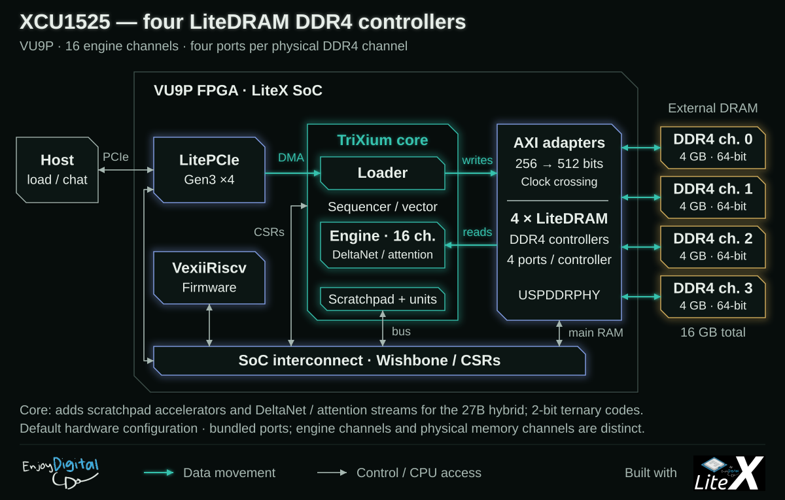
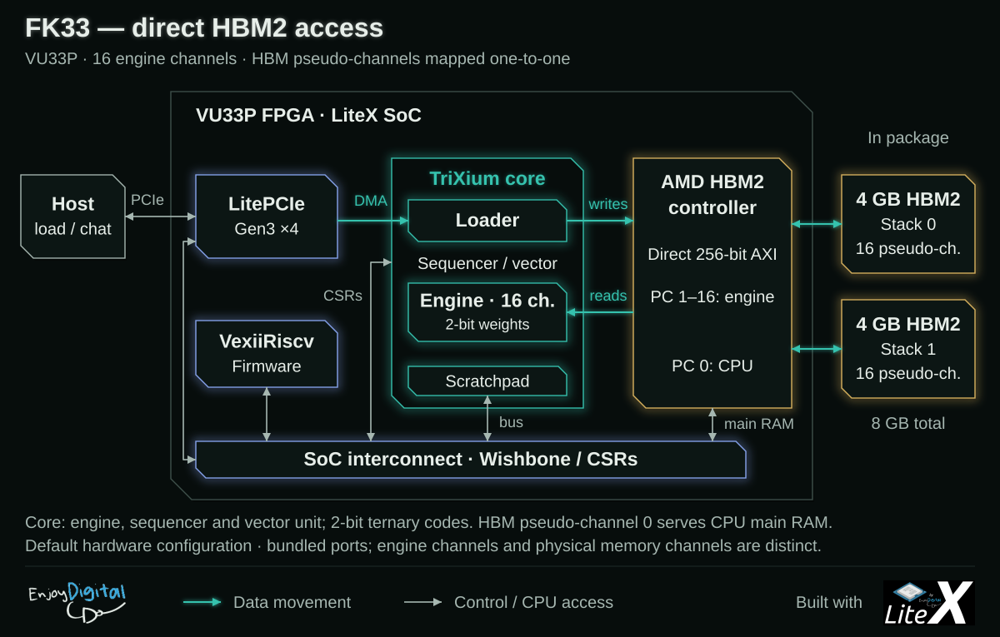
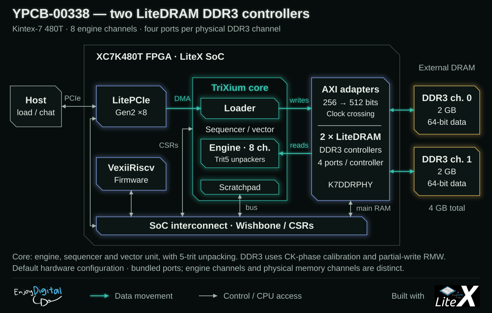

# Boards

TriXium runs on two SQRL cards: the **XCU1525** (XCVU9P, 4x DDR4) and the **FK33** (XCVU33P,
HBM2), and the **Inspur YPCB-00338-1P1** (XC7K480T, 2x DDR3). The targets instantiate
the same `TriXiumCore` (16 engine channels on the SQRL cards, 8 on the YPCB-00338);
they differ in the memory system, the clocks and the bring-up.
Builds need Vivado **2024.1** (the 2025.2 install lacks the VU33P).

| | XCU1525 | FK33 | YPCB-00338-1P1 |
| --- | --- | --- | --- |
| FPGA | XCVU9P (3 SLRs) | XCVU33P (1 SLR) | XC7K480T-2 |
| memory | 4x DDR4 x64, 4 GB each (LiteDRAM, USPDDRPHY) | 8 GB HBM2, 16 of 32 pseudo-channels | 2x DDR3 x64 (the ninth, ECC lane used by the ECC build), 2 GB each (LiteDRAM, K7DDRPHY on HR banks, CK phase shift) |
| clocks | sys 125 MHz, DDR4 controllers 187.5 MHz (DDR4-1500) | sys = HBM AXI 212.5 MHz, HBM 800 MHz | sys 125 MHz, DDR3 controllers 133.33 MHz (DDR3-1066); `--hybrid` build: sys 100 MHz, channel pipes 133.33 MHz, DDR3 controllers and channel readers 116.67 MHz (DDR3-933) |
| PCIe | Gen3 x4 (LitePCIe) | Gen3 x4 (LitePCIe) | Gen2 x8 (LitePCIe) |
| units | every scratchpad unit, DeltaNet + attention streams | engine, sequencer, vector unit (no scratchpad units) | as the FK33; `--hybrid`: the hybrid models' units sized for the part (4 channels; the attention stream at 8 lanes / 2 groups, one pass for the 2B's heads and two for the 4B's; the DeltaNet stream at two sub-lanes per channel, a 128x128 head in 2,048 clocks; Hadamard 16 lanes), the norm unit's RoPE stage on, DFI command statistics (`ddrstat`) and no vector unit (the hybrid path never runs it; this bitstream runs the hybrid models only): `ypcb_hyb9_d100`, 253k LUTs (85%) |
| models | Ternary-Bonsai-2 27B, Ternary-Bonsai 8B / 1.7B | Ternary-Bonsai 8B / 1.7B | Ternary-Bonsai 8B / 1.7B; `--hybrid`: Ternary-Bonsai-2 2B / 4B |
| target | [`trixium_xcu1525.py`](../trixium_xcu1525.py) | [`trixium_fk33.py`](../trixium_fk33.py) | [`trixium_ypcb.py`](../trixium_ypcb.py) |
| build | `./trixium_xcu1525.py --build` | `./trixium_fk33.py --build` | `./trixium_ypcb.py --build` |
| load | `./trixium_xcu1525.py --load` (openFPGALoader) | `./trixium_fk33.py --load` (OpenOCD) | `./trixium_ypcb.py --load` (openFPGALoader, HS2 cable) |
| deploy | `trixium deploy --board xcu1525 --model 27b` | `trixium deploy --board fk33 --model 1p7b` | `trixium deploy --board ypcb --model 1p7b` (hybrid build: `--model 2b`) |

## Known issues

Recording the demo GIF (2026-10-15) showed greedy replies changing from one run to the next. The
design and its simulation are exact; two boards' memory systems are not always:

- **YPCB-00338: DDR3 read errors under full streaming.** Repeating the same matvec, about one
  run in 100 to 300 returned one wrong output row, from DDR3 controller 1's channels in the runs
  analysed. Shifting every bit's read delay while the engine streams shows a clean window of
  only ~2-3 IDELAY taps (~150-230 ps of the 938 ps bit), against the ~10 taps the calibration's
  single-burst checks see; it is worse hot and varies from one calibration to the next. The PHY
  captures reads on the FPGA clock (CK phase mode), so the DRAM's output timing drift under load
  eats the window; on a small, quiet LiteX-Boards design the same card has several taps of
  margin. Full-performance input buffers (`IBUF_LOW_PWR=FALSE`) and the DRAM drive strength
  (34 / 40 ohm) did not change it. **Fix: SECDED ECC on each channel's ninth byte lane** (a
  DFI-level ECC in LiteDRAM, the leveling extended to 72-bit channels). Validated on the card in
  a LiteX-Boards design: every injected single-bit fault corrected, double-bit faults flagged.
  The TriXium build with ECC meets timing (WNS +0.006 ns, 215k LUTs, area unchanged) and runs on
  the card with correct tokens at 35.17 tok/s on the 1.7B. Per-DQ error counters (added to the
  ECC) then showed why ECC alone is not enough at DDR3-1066: under generation load, controller 1
  needs hundreds of thousands of corrections per reply, concentrated on a few bits that change
  with every calibration and drift as the card warms, with enough double-bit errors to defeat
  SECDED; controller 0 stays almost clean. **A DDR3-933 build** (DDR 116.67 MHz, sys 127.27 MHz)
  cuts controller 1's errors about 400x at 31.8 tok/s on the 1.7B; its remaining errors sit on
  a few bits that change with every leveling (one boot: ~600 corrected and 2-7 uncorrectable
  reads per 24 tokens, 91% on one bit; a bad one: 64k and 26k). **Root cause and fix
  (2026-10-17): the leveling centres each bit in the wrong eye.** Its per-bit window comes
  from a few DFI-injected bursts per tap and is 10-13 taps wide; the LiteDRAM BIST's single
  stream sees 6-8; the engine's concurrent channel streams see 2-3, so a bit "centred" by the
  leveling sits on the real edge (DQ14 at tap 15: taps 13-14 clean, 15 = 1,633 errors per 24
  tokens, 16 = 789,690). The firmware now re-levels controllers 1.. at boot and runs an
  ECC-guided scan (`ddr_ecc_scan`, console `eccscan [k] [range] [passes]`): every bit's tap at
  leveled + off for off in -6..+6, a synthetic trit5 matvec streaming a BIST-written 32 MB
  region of every channel window at each offset, the ECC per-bit counters marking the bits in
  error, each bit then moved to the centre of its clean run. On the card (2B, 64 tokens):
  8 corrected, 0 uncorrectable, where the same boot's leveling alone gave 346 and 4 and a bad
  one 63,685 and 25,902. The ECC is upstream since 2026-10-17 (LiteDRAM #423, LiteX #2679,
  LiteX-Boards #928). The per-bit re-centring is proposed for liblitedram's leveling with the
  BIST as its oracle (LiteX #2681, 2026-10-18), with this caveat measured here: no single-port
  pattern sees the narrow eye - a sequential BIST read, a random-address one, a read with
  concurrent writes, or one engine channel's sequential stream alone (128-256 MB each, at tap
  offsets where the two concurrent channel streams give 178k corrected reads per 3 tokens) all
  read clean - and so do (2026-10-18, `fetchbist`) a BIST read interleaved with one engine
  stream on the same controller (two ports) and a stream loading the other controller. Only
  the engine's matvec streaming (two channels per controller feeding the adder trees) and the
  forwards see it: not a DRAM command pattern, the design's own activity. So the leveling's
  BIST step cannot be the oracle; #2681 instead exports the scan with a traffic callback
  (`sdram_ckphase_eye_refine`, the taps through `sdram_ckphase_bit_tap[_set]`), and the card
  shows why in one boot: the BIST reads see 8-9 clean taps on every bit (2 of 72 moved), the
  engine's scan right after sees 2-3 taps one tap lower (65 of 72 moved). Even the engine's
  synthetic streams are not the last word: on the
  `ypcb_hyb7_d100` bitstream they saw bit 1 of lanes 4, 5 and 6 centred in a 5-tap eye while
  the inference left them 150-500 corrected and a few uncorrectable reads per 16 tokens (one
  tap earlier: 2 and 0; one tap later: 1.7 M and 225 k) - the forwards' own traffic (the
  DeltaNet state's reads and writes among them) has a narrower, shifted eye. So every hybrid
  model load ends with the same scan under the model's own forwards (`ddr_eye_scan`, console
  `eyescan [k] [range] [forwards]`: a forward per offset from the checkpoint and back, as a
  retry re-runs one; ~2 s), after which the bench runs with 0 corrected reads and no retry.
  Behind it, the firmware re-runs a forward during which a controller flagged an uncorrectable
  read: the weights in DRAM are intact, the errors are transient. A Qwen3 forward is idempotent
  once its position is restored; a hybrid one (Bonsai 2) once its DeltaNet state is
  double-buffered (engine op 5 writes the other set). On the card (build `ypcb_hyb6_a`, WNS
  −0.360 ns, 2B 12.61 and 4B 5.76 tok/s): `eccforce 8` forces eight forwards to run twice and
  the generation stays golden (retries 8, unrecovered 0).
- **The 2026-10-19 builds** (all `--ddr-quiet-regions`): `ypcb_hyb13_d100` adds the pipe clock island (`--pipe-clk-freq 125e6`: each channel's unpacker and pipe in a 125 MHz domain, the weight stream at the port's rate, 2B 16.78 tok/s), `ypcb_hyb14_d100` the DeltaNet stream at 4 sub-lanes (`--dn-sublanes 4`, 17.30, controller 0 showed a marginal DQ8 with corrected reads only), **`ypcb_hyb15_d100`** the attention softmax unit (17.49; 16.90 at 256 tokens, 14.06 at 1,024; 239k LUTs, 0 ECC errors on both controllers: the shipping build), `ypcb_hyb16_d100` both (266k LUTs, 89%: the fastest, 2B 18.06 tok/s, 4B 8.06, but a controller-1 eye the boot scan had to move 37 of 72 bits for and that still gives uncorrectable reads on DQ14 under the benches (forward retries, golden output): the density lottery again, so hyb15 ships). The firmware list steps of the same evening (fused per-sub-block lists, the DeltaNet heads op in its list, the LM head at 24,576-row chunks without logits stores, hb left in the scratchpad) bring hyb15 to **2B 18.45 tok/s (64 tokens), 17.79 (256), 14.68 (1,024); 4B 8.15, 7.80 at 256**, golden, 0 ECC errors, with no bitstream change. **`ypcb_hyb17_d100`** (2026-10-19, 23:15) adds the readers in the controllers' ddr clock (`--ddr-readers`, gateware/core/reader_island.py): 239.3k LUTs (80.1%), 758 BRAM (the read-side crossing FIFOs gone), WNS +0.053 ns (closed), golden; `mvbw 13 0 8` 0.98 beats per channel per clock (hyb15: 0.95; the pipe at 1.19 of its 1.25 is the cap now), 2B **18.79 tok/s** at 64 tokens, 18.09 at 256, 14.89 at 1,024; 4B **8.50** (8.15); controller 1's eye under inference 3-4 clean taps, 6 of 72 bits moved; 0 uncorrectable reads, but controller 0's DQ6 (BIOS-levelled, outside the firmware's scan) logs corrected reads on this netlist (26 per 1,024 2B tokens, 65 per 96 4B tokens; hyb15: 0-2). `ypcb_hyb18_d100` (2026-10-20, 00:21) = hyb17 with the pipes at 133.33 MHz: WNS +0.059 ns (pipe clock +0.529 at 7.5 ns), 239.2k LUTs, golden; `mvbw` 1.04 beats per channel per clock (the pipe at 1.26 of its 1.33), 2B **19.47 tok/s** at 64 tokens, 18.50 at 256, 15.20 at 1,024; 4B 8.50 (unchanged). Not shipped yet: controller 0 - BIOS-levelled, outside the firmware's eye scan - logged 5,703 corrected and **12 uncorrectable** reads on DQ11 over the 2B's 1,344 benched tokens and 343 / 1 on DQ6 over the 4B's 96 (every one recovered by the forward retry: output golden, 0 unrecovered), against 0-2 corrected on hyb15: the engine datapath's faster switching sits in controller 0's clock regions (the `--ddr-quiet-regions` Pblock excludes controller 1's only). `ypcb_hyb19_d100` (01:37) = hyb18 with the pipes at 142.857 MHz: WNS -0.049 ns on 2 endpoints (the pipe clock itself +0.446 at 7 ns), golden, `mvbw` 1.04 again - the memory side caps the stream at ~1.04 beats per channel per clock, so the pipe clock's lever ends at 133 MHz - 2B 19.48 tok/s at 64 tokens, 18.50 at 256, 15.25 at 1,024; 4B 8.63; controller 0 marginal again on a different bit (DQ13: 438 corrected, 7 uncorrectable over the 2B's long benches, retried; 0 on the 4B). `--ddr-quiet-regions both` (controller 0's regions X0Y0-X0Y2 excluded too) **`ypcb_hyb20_d100`** (02:43) = hyb18 + `--ddr-quiet-regions both`: WNS +0.039 ns (ddr +0.048, sys +0.045, pipe +0.703 at 7.5 ns), 239.3k LUTs (80.1%), 758 BRAM, 407 DSP, golden, `mvbw` 1.04; 2B **19.47 tok/s** at 64 tokens, 18.71 at 256, 15.30 at 1,024; 4B **8.63**, 8.22 at 256; **0 corrected, 0 uncorrectable reads on both controllers** through 1,344 2B and 352 4B tokens (hyb18, the same netlist without controller 0's exclusion: 5,703 + 12 on DQ11): the DDR3-933 build. **`ypcb_hyb21_d100`** (2026-10-20) = hyb20 at DDR3-1066 (`--ddr-clk-freq 133.333e6`, pipes at 142.857 MHz): 239.2k LUTs, WNS -0.440 ns on 11 endpoints (each clock closes on its own: ddr +0.071, sys +0.006, pipes +0.322), golden; `mvbw` 1.11 beats per channel per clock; 2B **20.33 tok/s** at 64 tokens, 19.49 at 256, 15.81 at 1,024; 4B **9.23**; ECC over ~5,500 benched tokens on two boots: a few dozen corrected reads and 2 uncorrectable ones on controller 1, both repeated by the forward retry (output exact): the fastest build, with the retry as its safety net. `ypcb_hyb22_d100` (hyb20 + DeltaNet at 4 sub-lanes) does not route (global congestion level 6). `ypcb_m1_n2` (03:37, the small boards' milestone M1: `--engine-channels 2 --dn-sublanes 4 --pipe-clk-freq 125e6`, full units): WNS +0.017, 218.0k LUTs, 631.5 BRAM, golden, 0 ECC errors, 0.97 beats per channel per clock, 2B 11.47 tok/s at 64 tokens, 11.28 at 256, 9.96 at 1,024 (the 2B over two DDR3-933 channels: half the stream rate, the same serial work). `ypcb_m1b_lite_n2m1` (04:16, M1b: the lite profile at 2 channels on controller 0 alone, `--engine-memctrl 1 --profile lite`): WNS +0.033, 155.0k LUTs (52%), 574 BRAM, 226 DSP; its image is `bonsai2-2b-n2-m1-ypcb.img` (`convert --channels 2 --memctrl 1`); on the card: golden, 0 ECC errors, 2B 10.32 tok/s at 64 tokens, 9.21 at 256, 6.19 at 1,024 (the softmax on the CPU costs the long context) - the single-DRAM topology of the small boards runs. **Efinix Ti375 C529 (`trixium_ti375.py`, 2026-10-21, first bitstream, not yet on the kit):** the hard LPDDR4x controller's one 512-bit AXI4 port shared by the CPU and four engine channels (AXISharedPort), the lite units with the DeltaNet stream at width 4, Etherbone and the UDP weight port over RGMII; 189k LUT4 / 126k FF / 2,268 RAM10 / 243 DSP48, 75.5% of the logic cells, timing met at 100 MHz (105.8 MHz achievable). Efinity 2025.1: `LITEX_ENV_EFINITY=/opt/efinix/efinity/2025.1`. Switch models through a firmware reboot (`deploy.py --no-reconfigure --boot`): a 4B load onto a running 2B firmware kept the tokens golden but logged ~1,300 corrected reads over every DQ of both controllers in 288 tokens (the read eye is centred at boot).
- **The read eye under streaming is a placement lottery too** (2026-10-18). `ypcb_hyb8_d100`
  (240k LUTs, 80%, WNS +0.029 ns) leveled normally (DFI windows of 10-14 taps, the 256 MB
  single-stream BIST clean) and every single-stream or two-port pattern read clean, yet under the
  engine's four streams controller 1's byte lanes 0-2 had no clean tap within ±8 and lanes 3-8 one
  or two: `mvbw` alone 42k corrected / 15k uncorrectable per 8 reps, the bench on ECC retries,
  a reloaded model wrong. The same streaming logic placed differently (`ypcb_hyb7_d100`: 2-3 clean
  taps, `ypcb_hyb9_d100`: 3-4) reads clean. The cause is the fabric's switching next to the DQ
  capture: controller 1's byte lanes sit in clock regions X0Y5-X0Y7 (banks 16-18), and the same
  hyb8 netlist rebuilt with the matvec engine kept out of those three regions (`ypcb_hyb8q_d100`,
  `--ddr-quiet-regions`: a post-synthesis Pblock on the engine's cells) has a healthy eye again
  (2-3 clean taps on every bit, `mvbw` clean, 14.73 tok/s golden). So the hybrid build keeps the
  engine out of controller 1's regions, and every new bitstream is still qualified with
  `mvbw 13 0 8` between `eccbits clear` and `eccbits`, or the `eyescan` table, before its speed
  counts.
- **XCU1525: one DDR4 controller trains marginally on some boots.** The weights read back from
  that controller's four channels differ from the image (stably, so the writes are wrong), and
  its KV-cache writes make attention vary from run to run; about half the boots of 2026-10-15
  did it, a different controller each time. The 64-beat `ddrtest` and the BIOS memtest
  (controller 0 only) do not see it. **Fix, on the development branch:** a boot-time deep
  write/read test (`ddrdeep`, 512 random blocks per channel, before the upload) that retrains a
  failing controller until it passes, plus a per-channel weight checksum (`wsum`) against the
  image; five boots in a row came up clean, one of them after catching and retraining
  controller 1.
- **The deploy's token check** compares the first 9-16 tokens; it will gain a long greedy
  generation repeated several times, which is what catches both issues above.

## Build

```sh
./trixium_xcu1525.py --build                    # -> build/xcu1525/, build/xcu1525.verdict
./trixium_xcu1525.py --build --sys-clk-freq 137.5e6 --output-dir build/xcu1525_137
./trixium_fk33.py --build                       # -> build/fk33/, build/fk33.verdict
```

The targets' defaults carry the shipping recipe: the CPU configuration (VexiiRiscv, 32 KB
I$/D$, branch prediction, Zbb, Zcbm, the FPU on the XCU1525), the Vivado directives the designs
closed with, Vivado 2024.1 (`--vivado-settings`, or `LITEX_ENV_VIVADO`) and the driver headers
of the build (`build/<name>/driver/`). The exit code goes to `build/<name>.verdict`: a
successful Vivado run is not enough, the timing gate ([`software/lab/timing.py`](../software/lab/timing.py))
on the routed report decides (the XCU1525 prints the strict verdict for information and ships
on `--experiment` under the DDR4 approval below, `--timing-approval`; the FK33 on the default
gate). A VU9P route needs ~15 GB of disk and ~25 GB of RAM, a VU33P route ~11-15 GB of RAM;
`trixium validate` builds both in parallel.

Target knobs (`./trixium_xcu1525.py --help`, `./trixium_fk33.py --help`):

| target | option | default |
| --- | --- | --- |
| xcu1525 | `--sys-clk-freq` | 125e6 |
| xcu1525 | `--ddr-clk-freq` (4:1, data rate 8x) | 187.5e6 (DDR4-1500) |
| xcu1525 | `--engine-channels` (multiple of 4) | 16 |
| xcu1525 | `--cpu-slr` (SLR of the CPU pblock) | 1 |
| fk33 | `--sys-clk-freq` (= HBM AXI clock) | 212.5e6 |
| fk33 | `--engine-channels` (pseudo-channels 1..N, max 31) | 16 |
| ypcb | `--sys-clk-freq` | 125e6 |
| ypcb | `--ddr-clk-freq` (1:4, data rate 8x) | 133.33e6 (DDR3-1066) |
| ypcb | `--engine-channels` (multiple of 2; the bank skew follows) | 8 |
| ypcb | `--trit5` / `--no-trit5` (5-trit weight codes) | on |
| ypcb | `--prefetch` (weight prefetch: reader FIFO beats per channel, 0 = none) | 2048 |
| ypcb | `--vec-fused` / `--no-vec-fused` (fused vector instructions) | on |
| ypcb | `--read-time` / `--write-time` / `--refresh-postponing` | 256 / 128 / 1 |

### The timing gate

[`software/lab/timing.py`](../software/lab/timing.py) turns the routed timing report into a verdict
(the targets run it after a build, `trixium deploy` again before configuring the card; by hand:
`python3 -m software.lab.timing build/fk33/gateware/sqrl_fk33_timing.rpt`):

- default: SHIP when the misses are no worse than the builds that have run on the card
  (the FK33's gate: its shipping v16b has WNS -0.315 ns, TNS -438.5 ns).
- `--strict` (full closure): setup and hold closed, pulse-width/skew family closed or within a
  named baseline (`--serializer-baseline v8|v8-exact`: the OSERDESE3 CLK/CLKDIV
  skew of the DDR4 PHYs misses by a few picoseconds on every XCU1525 build).
- `--experiment` (board tests of a concept): setup WNS >= -0.75 ns and at most 20,000 failing
  endpoints, hold met. Outside this envelope it refuses and `--force` cannot override it: a
  build at -0.82 ns with ~87k failing endpoints took the host down on reconfigure.
- `--approval <name>`: a per-build exception. `ddr4-overclock` covers the DDR4 overclock
  below.
- `--board <name>` (any mode): the clock periods the board's report must time
  (`REQUIRED_CLOCKS`); a missing one refuses the build before any verdict. The YPCB's target
  and deploy pass `--board ypcb`: its first build had the 50 MHz input unconstrained, and the
  summary (the PCIe clocks alone) passed the strict gate.

**DDR4-1500 is an approved overclock.** LiteDRAM's USPDDRPHY uses component-mode ISERDESE3
whose minimum period on the -2 VU9P is 1.600 ns (625 MHz, i.e. DDR4-1250). At DDR4-1500
(1.333 ns) the report shows a Min Period violation on ~940 serializer clock pins; it is a
datasheet limit, not closable timing. The board trains and runs exact at 1500 (read eyes
132-152 taps); at 1600 the eyes close (44 taps) and one controller does not train. The
build and the deploy pass `ddr4-overclock` (`--timing-approval`, `trixium deploy
--approval`); more bandwidth needs a native-mode PHY.

## XCU1525



### Memory layout

Engine channel `c` streams from controller `c // 4` through its own 512-bit crossbar port (an
AXI bridge that merges two 256-bit beats per controller word,
[`gateware/memory/ddr.py`](../gateware/memory/ddr.py)), crossed from the `ddr` clock domain to
`sys` at the AXI level. Per controller (4 GB): `main_ram` at 0..256 MB on controller 0 (the
CPU, through the L2), the BONS header staging area below 320 MB, then four 704 MB channel
windows at a 1 GB stride, each offset by a 32 KB bank-group skew so the four streams of a
controller never share a DDR4 bank. The last window loses 96 KB to the skew: XCU1525 images
are converted with that stride and reserve.

```sh
trixium convert --board xcu1525 models/8b/Ternary-Bonsai-8B-PQ2_0.gguf        # -> models/bons/bonsai-8b-n16-xcu1525.img
trixium convert --board xcu1525 models/27b/Ternary-Bonsai-2-27B-PTQ1_0.gguf   # -> models/bons/bonsai-27b-n16-xcu1525.img
```

The 1.7B image is the FK33's (`trixium convert`), byte-identical. The 27B GGUF
(`Ternary-Bonsai-2-27B-PTQ1_0.gguf`, PrismML) goes in `models/27b/` with its
`tokenizer.json` (`trixium tokenizer models/27b/tokenizer.json`); `trixium models` fetches
the 1.7B and 8B only.

### DDR4 calibration

LiteX's liblitedram cannot calibrate this board on its own: it reads back what it wrote and
cannot tell a wrong read delay from a wrong write delay, and some byte lanes come out of write
leveling at the edge of their eye. Three pieces fix it:

- LiteX's liblitedram DDR4 MPR read leveling (upstream since October 2026): read leveling on
  the DDR4 MPR patterns (no writes) before write latency calibration. The BIOS and
  `firmware/ddr.c` both run it.
- The target sets `write_dq_dqs_training` on the PHYs (liblitedram's DQ-DQS centring).
- [`software/host/rdlevel.py`](../software/host/rdlevel.py), run on the host over BAR0: a write-side search with the reads
  trusted (DQS against CK, write bitslip, DQ against DQS), centring, then read leveling;
  ~2 s per controller.

On the board host (the deploy copies `software/` there and its boot runs it):

```sh
sudo python3 -m software.host.rdlevel train           # controller 0
sudo python3 -m software.host.rdlevel train --ctrl 2
sudo python3 -m software.host.rdlevel check --ctrl 2  # error bits per module
```

Never train controller 0 while the firmware executes from it (no refresh, no CPU for
~100 ms: the firmware dies). LiteDRAM's 256-bit native up-converter pipelines its reads
(`read_depth`, 8 in flight, upstream); the shipping target uses 512-bit ports, the 256-bit
port path is covered by `test/gateware/memory/test_ddr.py`.

### Deploy

```sh
trixium deploy --board xcu1525 --model 27b                      # bitstream + boot + tokens + bench
trixium deploy --board xcu1525 --model 8b   --no-reconfigure      # next model, same configuration
trixium deploy --board xcu1525 --model 1p7b --no-reconfigure
```

`trixium deploy` ([`software/lab/deploy.py`](../software/lab/deploy.py)) runs from the workstation
against the `[xcu1525]` host of `~/.config/trixium/boards.ini` (format:
[`boards.ini.example`](boards.ini.example); ssh key, sudo through an askpass helper) and
refuses to continue at the first failed step (`--dry-run` prints every command):

1. timing gate (`--experiment` with the approval; the strict verdict is printed alongside);
2. firmware and both header flavours from the build (generated `soc.h` and the driver's
   `kernel/*.h`), host tools and driver built on the host;
3. detach the PCIe endpoint, program with openFPGALoader (`-c ft4232 --fpga-part xcvu9p`),
   verify configuration by the IR capture through openocd (0x35 in each SLR), warm reboot;
4. boot sequence of the board-side session
   ([`software/host/board.py`](../software/host/board.py), `sudo python3 -m software.host.board boot 27b` on the host):
   CPU reset, BIOS calibrates controller 0, host training of controller 0, firmware boot
   without a CPU reset, the firmware calibrates controllers 1-3, host training of 1-3,
   `engreset`, `ddrtest` over the 16 channels;
5. weights (`trixium_load`; check the per-channel base lines), tokens against the reference,
   then `bench` and `stats`.

Reference tokens (greedy):

| model | prompt ids | expected continuation |
| --- | --- | --- |
| 1.7B | `785 6722 315 9625 374` | `12095 11 323 279 6722 315 17689 374 24081` |
| 8B | `785 6722 315 9625 374` | `12095 13 576 6722 315 9625 374 12095 13 576` |
| 27B | `760 6511 314 9338 369` | `11751 13 198 760 6511 314 9564 369` (PrismML's llama.cpp) |

### Rules

- **JTAG is exclusive.** A leftover `openocd` (e.g. from `litex_server --jtag`) holds the
  FT4232H: openFPGALoader then fails, the card keeps the old bitstream and the boot trains a
  removed device. Kill stray openocd processes by PID before a deploy. openocd 0.11 cannot
  program the three-SLR VU9P (it reports "loaded" with every SLR unconfigured).
- **DDRTEST before tokens.** Wrong tokens after DDRTEST errors: re-upload the weights first,
  do not debug the firmware. At sys 137.5 MHz controller 1 shows ~160 errors per channel
  after training (tokens still exact); at 125 MHz 1-2.
- **The PCIe rules of the FK33 below apply here too** (detach, warm reboot, `cpu_rst`).

### Timing (2026-10-12 analysis)

The release-tree build missed the deploy floor in `ddr_clk` (-0.966 ns, 8,949 endpoints; sys
+0.042 ns). Its netlist is v30b's (the Verilog differs only in statement order and the BIOS ROM
size), so the regression is placement, not logic: v30 routed at -1.399 ns, v30b at -0.423 ns
with the same design. Failing families, from the routed checkpoint (all net-dominated: 4.4 ns
of route for 0.8 ns of cells on average, period 5.33 ns):

| family | endpoints | worst | why |
| --- | ---: | ---: | --- |
| ddr reset synchronizer (one flop, 1,401 pins over three SLRs) | 2,673 | -0.89 | fan-out |
| LiteDRAM bankmachine -> multiplexer `choose_cmd` -> `cmd_ready` loop | ~1,700 | -0.95 | 15-17 levels, spread |
| AXI-to-native bridge `w_buffer_level` -> `wdata.ready` -> FIFO read | ~1,500 | -0.93 | 11-17 levels, SLR2->1 |
| DDR CSR bus `s_adr` -> PHY IDELAY/ODELAY CE | ~600 | -0.83 | 2-3 levels, an SLR away |

Controllers 0 and 3 have their I/O in SLR0 and SLR2 (banks 41-42, 70-72), 1 and 2 in SLR1
(65-67, 46-47); the placer puts all four controllers in SLR1 with the CPU, and the TriXium core
adds 184k LUTs there (SLR1 55 % full, SLR0/SLR2 38 %).

Isolation (the SoC with the core replaced by an AXI traffic stub, `ddr_clk` alone): -0.190 ns,
the CSR family only. Hence three fixes, in the RTL:

1. the ddr reset through a replicated register tree (`_CRG`, `max_fanout`);
2. the DDR CSR bus with two registered hops per controller (`PipelinedDDRCSR(hops=2)`);
3. each IDELAY/ODELAY CE registered next to its delay (`register_delay_controls`): the CSR
   strobe still fanned out to ~170 delays over two or three banks after fix 2.

With all three the isolated DDR domain closes (+0.073 ns, strict gate PASS); its limiters are
the two LiteDRAM loops above. In the full design they still miss (-0.925 ns after route): the
core's crowding of SLR1 decides. Tried and refused:

- per-controller SLR pblocks by cell name: the controllers' FSMs and crossbar shift registers
  carry other names, the pblocks split each controller across SLRs (-1.770 ns, DDR-only);
- an exclusive pblock for every `ddr_clk` cell (64.8k cells, 15 clock regions of SLR1): pulls
  controllers 0 and 3's PHY logic away from their I/O, -6.7 ns post-place.

The core alone (out of context, xcvu9p -2L, 125 MHz, placed and routed) closes at +0.039 ns: its
thinnest paths were the scratchpad's BRAM output into the attention stream's 24 operand LUT
RAMs (zero logic levels, ~1,640 paths under +0.08 ns), now registered.

**The bridge loop, broken (2026-10-13).** LiteDRAM's AXI-to-native write path
(`LiteDRAMAXI2NativeW`) now gates on registers: `can_write` comes from one counter of the
buffered write data no command has claimed yet (a flop, where it was a compare of the FIFO level
with the reservation counter), and the write data is released from the registered reservation
level alone (the controller asks for a command's data at least one cycle after accepting it, so
the same-cycle `cmd.ready` term was never needed). Exactly equivalent: LiteDRAM's AXI tests, the
bit-exact gate, the random-init gate with a mid-run soft reset, the FK33 and YPCB simulations
and the fast tier pass. Effect:

| build | ddr_clk WNS | worst ddr path |
| --- | ---: | --- |
| DDR-only, three fixes above | +0.073 ns | the bridge: `w_buffer_level` -> write FIFO BRAM read enable |
| DDR-only, + the bridge | +0.080 ns | PHY register -> OSERDES/ODELAY (0-2 levels, I/O placement); no bridge or bankmachine path in the worst ones |
| full XCU1525, all fixes | **+0.098 ns** | sys **+0.048 ns**, 0 failing endpoints: the strict release gate passes |

This needs LiteDRAM with that change, upstream since LiteDRAM #417 (the registered AXI write
gating). Without it the build is the -0.925 ns one above.

Still unused, should the margin shrink (the fused prepare adds ~4.3k LUTs): the core-exclusion
pblock (the core kept out of a region next to the DDR I/O, the PHYs staying by their banks), a
registered `cmd_ready` in LiteDRAM's crossbar, DDR4-1400 (175 MHz, +0.38 ns of period, ~5 % of
the 27B's rate).

## FK33



### Safety

- **Mount a fan over the heatsink before power-on.** The card is passively cooled and
  expects server airflow; its VCCHBM regulator is undersized (the design uses 16 of the 32
  HBM ports at 800 MHz). `trixium_smi info` prints the FPGA temperature: stay below 85 °C,
  abort above 95 °C.
- The bitstream lives in SRAM only: **warm reboots only** after programming; a power cycle
  loses the design.

### Programming: openocd, not openFPGALoader

openFPGALoader reports `done 1` but does not configure the FK33: its JPROGRAM restarts the
board's SPI boot and the factory image wins (`lspci` shows `1e24:1533` instead of `10ee:`,
every CSR reads 0).

```sh
./trixium_fk33.py --load                        # OpenOCD pld load of build/fk33, ~40 s
```

`--load` uses litex-boards' OpenOCD programmer for the FK33 (onboard FT2232,
`prog/openocd_xcvu33p_ft2232.cfg` in litex-boards).

### Deploy

```sh
trixium deploy --board fk33 --model 1p7b
trixium deploy --board fk33 --model 8b
```

Same sequence as the XCU1525 without the DDR4 steps: timing gate, firmware and both header
flavours, driver built on the host, detach + `openocd pld load` + warm reboot, `trixium_load`,
`trixium_chat -k` (CPU reset, firmware through the loader, `TRIXIUM-READY`), tokens, then
`bench 64` + `stats`. Same reference tokens as the XCU1525 table. Reference: 1,998k
cycles/token, 106.3 tok/s on the 1.7B at 212.5 MHz.

## YPCB-00338-1P1



Inspur's YPCB-00338-1P1 (XC7K480T-FFG1156-2, two 72-bit DDR3 channels of nine MT41K256M8, PCIe
Gen2 x8; documented by TiferKing, litex-boards `ypcb_00338_1p1`). openTPU (FeSens) also runs on
this card, with different trade-offs ([`related-work.md`](related-work.md#opentpu-on-the-same-card)).
TriXium's targets: Ternary-Bonsai 1.7B >= 32 tok/s (0.457 GB streamed
per token), 8B >= 7 tok/s (2.010 GB), against the two channels' 17.06 GB/s peak.

Status (2026-10-15): both targets met on the card, tokens checked: the 1.7B decodes at **35.2
tok/s** and the 8B at **8.11 tok/s** with eight engine channels, 5-trit weight codes, the
engine's weight prefetch and the fused vector instructions (the defaults; below). Eight channels
and 5-trit codes alone gave 32.1 / 7.83 tok/s; the first run, four channels and 2-bit
codes, gave 27.0 / 6.44 tok/s. An earlier host never trained a PCIe link with any
image: its slot, not the design.

| | |
| --- | --- |
| area (placed) | prefetch + fused (`build/ypcb_pff2`): 216.0k LUTs (72 %), 856.5 BRAM tiles (90 %); 208.8k LUTs (70 %), 151.0k FFs, 772.5 BRAM tiles (81 %), 558 DSPs (`build/ypcb_t5n8c`); four channels, 2-bit: 126.4k LUTs, 489.5 BRAM tiles |
| timing | prefetch + fused (`build/ypcb_pff2`, 2026-10-15): WNS +0.004 ns, all clocks met (the RMW write-path register of litedram #422, the engine's absmax tree registered; without them -0.829 ns); eight channels, trit5 (`build/ypcb_t5n8c`, 2026-10-14): WNS -0.154 ns on 1,065 endpoints (sys and ddr), runs clean on the card; four channels, sys 125 MHz (`build/ypcb`, 2026-10-11): WNS +0.001 ns, WHS +0.017 ns, pulse width met, 359k endpoints, the strict gate with the clock coverage passes; sys 150 MHz misses by -1.3 ns in the vector unit and the engine (thousands of endpoints) |
| simulation | `--board ypcb`: boot, self-test checksums, tokens against the mirror (both legs), `ddrtest` over the four windows; the calibration itself in the SoC on a fly-by channel model (`--ckphase-model`, `ddrinit 1`) |
| projected decode | 1.7B **25.8 tok/s**, 8B **6.65 tok/s** at sys 125 MHz, DDR3-1066 (below) |
| measured decode | 1.7B **35.2 tok/s**, 8B **8.11 tok/s** (`build/ypcb_pff2`, 2026-10-15, bench 64 / 32); without prefetch/fused 32.1 / 7.83 (`build/ypcb_t5n8c`); four channels, 2-bit: 27.0 / 6.44 (`build/ypcb_up`) |

**The projection.** `trixium_sim.py --board ypcb` with truncated Ternary-Bonsai images (the
models' full widths and LM head, 1 and 2 layers, a 1,024-token KV budget, no int16 embedding
table), on the board's memory system: LiteDRAM's controllers with the board's DDR3-1066 timings
and controller settings, the K7DDRPHY's read/write latencies (CK phase mode), the real 8-bank / 8 KB-row
geometry and bank skew, the board's sys/ddr clock ratio (`--sys-clk-freq`). The 2-layer decode
token minus the 1-layer one is a layer; a model's token is the 1-layer token plus its other
layers (short context, as the FK33/XCU1525 references):

| model | sys | 1 layer | 2 layers | per layer | cycles/token | tok/s |
| --- | --- | ---: | ---: | ---: | ---: | ---: |
| 1.7B (28 layers) | 150 MHz | 1,015,501 | 1,185,946 | 170,445 | 5,617,516 | 26.7 (27.0) |
| 1.7B | 133.33 MHz | 915,490 | 1,071,974 | 156,484 | 5,140,558 | 25.9 (26.2) |
| 1.7B | 125 MHz | 865,629 | 1,015,095 | 149,466 | 4,901,211 | 25.5 (25.8) |
| 8B (36 layers) | 150 MHz | 2,243,217 | 2,806,449 | 563,232 | 21,956,337 | 6.83 |
| 8B | 125 MHz | 1,905,156 | 2,388,156 | 483,000 | 18,810,156 | 6.65 |

(In parentheses: the card's 1.7B image keeps its int16 embedding table, a row fetch instead of
the ~60k cycles of CPU decode the truncated images pay per token; the 8B image has none either
way.) The FFN projections stream at 0.80-0.82 beats per channel per sys clock at 150 MHz,
90-92 % of the two controllers' peak (0.889 at 150/133.33 MHz); the LM head at 0.83. About a
quarter of a layer is non-streaming work (norms, attention, quantization, list setup: the
vector unit and the CPU, serial with the streams): the 1.7B target needs it hidden under the
streams (the streams alone: ~4.4M cycles, ~34 tok/s at 150 MHz). Measured levers: eight engine
channels (four windows per controller) stream the projections 3.5 % faster but leave a layer's
cycles unchanged (the 1-layer token: 984k against 1,016k); the controller settings move the token by
less than 0.25 % (`ddr_controller_settings()`); the sys clock only shortens the non-streaming
quarter.

### Memory layout

Engine channel `c` streams from controller `c // 2` through its own 512-bit crossbar port (the
XCU1525's AXI bridge and crossing, [`gateware/memory/ddr.py`](../gateware/memory/ddr.py)). Each
controller is a 64-bit DDR3 channel (eight x8 chips; the ninth, ECC, lane is not used: the
data path is 512 bits per controller word) of 2 GB. Per controller: `main_ram` at 0..256 MB on
controller 0, the BONS header staging area below 320 MB, then two 704 MB channel windows at a
1 GB stride, the second offset by a 32 KB bank skew.

The skew is DDR3 arithmetic: LiteDRAM's ROW_BANK_COL mapping on a 64-bit channel (1024 columns,
8 KB rows) puts the bank in byte address bits 13..15, so a stream changes bank every 8 KB and
goes round the 8 banks every 64 KB. Both windows of a controller stream the same relative
addresses at the same time (one descriptor drives every channel); 32 KB keeps them four banks
apart, so neither crossbar port waits on the other's bank lock nor thrashes its row. The second
window loses the 32 KB (the converter's window reserve).

```sh
trixium convert --board ypcb models/1.7b/Ternary-Bonsai-1.7B-PQ2_0.gguf   # -> models/bons/bonsai-1p7b-n8-ypcb.img
trixium convert --board ypcb models/8b/Ternary-Bonsai-8B-PQ2_0.gguf       # -> models/bons/bonsai-8b-n8-ypcb.img
```

`--board ypcb` defaults to 8 channels and 5-trit codes (`--channels 4 --no-trit5` for a 2-bit,
four-channel bitstream). At 8 channels each controller splits evenly into four 432 MB windows.
Per channel: the 1.7B is 49 MB of weights + 18 MB of KV + its 78 MB int16 embedding table
(126 MB payload, 1.01 GB image); the 8B 229 MB + 24 MB of KV + 155 MB of embedding table
(382 MB payload, 3.06 GB image).

### DDR3 on HR banks: PHY and calibration

The DDR3 banks (11-18) are high-range: no ODELAY, so LiteDRAM's 7-series PHY cannot write-level,
and each channel's nine chips hang on a fly-by command/clock bus. With one static DQS phase
only part of the lanes meet tDQSS. Both channels run at full width with write leveling by CK
phase instead. The HR-bank approach follows the YPCB-00338 bring-up documented by openTPU (FeSens).

Both halves are upstream (developed here, validated on the card, then contributed):

- The PHY: LiteDRAM's `K7DDRPHY(with_odelay=False, with_ck_phase_shift=True)` (LiteDRAM #418):
  the S7DDRPHY's structure with CK and the command pins on MMCM outputs with fine phase shift,
  DQ, DQS (+90 deg) and the read capture on static outputs of the same MMCM; one MMCM per
  channel, cascaded from the controller clock with its feedback through a BUFG; the commands
  cross into the shifted clock through falling-edge registers; a per-lane write latency
  (bitslip) and a per-bit read framing (`dq_dly_sel`).
- The calibration: liblitedram's CK phase leveling (LiteX #2670, #2671; `SDRAM_PHY_CKPHASE_STEPS`
  from the PHY), run by the SoC's own CPU (no host trainer): the CK phase is scanned over one tCK
  (fine steps of 16.7 ps); at each step a full calibration (JEDEC init, per-lane write latency,
  per-bit read leveling) and a LiteDRAM BIST under traffic (a single-burst DFI check is not
  enough); the channel settles in the middle of the longest run that every lane and the BIST
  pass. The BIOS levels both controllers at boot (`SDRAM_CSR_STRIDE`, `SDRAM_CONTROLLERS`);
  the firmware's `ddrinit 1` re-levels controller 1 (`sdram_ckphase_leveling(1)`).
- The simulation keeps a model of the PHY's CSRs and a fly-by channel
  ([`gateware/memory/ckphase_model.py`](../gateware/memory/ckphase_model.py)), checked against
  the PHY's settings (`test_ckphase_model.py`).

### Deploy

```sh
trixium deploy --board ypcb --model 1p7b
trixium deploy --board ypcb --model 8b --no-reconfigure
```

The XCU1525's sequence without the host training: strict timing gate, firmware and both header
flavours, driver built on the host, detach + OpenOCD `pld load` (DONE checked in the IR capture,
0x35; openFPGALoader before v0.12 does not know the XC7K480T) + warm reboot,
then `software/host/board.py boot --board ypcb`: CPU reset, the BIOS levels controller 0
(`CK phase leveling (controller 0)` ... `OK (BIST ...)`), passes its memtest and levels
controller 1, firmware boot without a CPU reset (`trixium_chat -R`), `engreset`, `ddrtest` over
the four channels; then the weights, tokens (the reference table above) and `bench`. JTAG: an FT232H
(Digilent HS2) cable on the card's header shows the FPGA alone; a Xilinx Platform Cable's chain
also has the card's CPLD (`--index-chain`).

### Eight channels and 5-trit codes

**2026-10-15, `build/ypcb_t5n8c`** (`./trixium_ypcb.py --build`: eight engine
channels, four windows per controller, the 5-trit unpackers, litedram #420/#421 for the ddr-domain
paths). `trixium deploy --board ypcb`, the images of `trixium convert --board ypcb`:

| | 1.7B | 8B |
| --- | --- | --- |
| tokens | the reference | the reference |
| decode (cycles/token) | 3,890,287 | 15,973,678 |
| decode | **32.1 tok/s** | **7.83 tok/s** |
| engine busy | 80 % | 85 % |
| four channels, 2-bit (below) | 27.0 | 6.44 |

`ddrtest` passes on all eight windows, `SPTEST` too.

**2026-10-15, `build/ypcb_pff2`**: the same, plus the engine's weight prefetch (op 7, 2048-beat
reader FIFOs) and the fused vector instructions
([`performance-next-steps.md`](performance-next-steps.md)); timing met (WNS +0.004 ns):

| | 1.7B | 8B |
| --- | --- | --- |
| tokens | the reference | the reference |
| decode (cycles/token) | 3,553,018 | 15,407,797 |
| decode | **35.2 tok/s** (+9.6 %) | **8.11 tok/s** (+3.6 %) |
| engine busy | 79 % | 85 % |
| prefetch | 9,546 hits, 0 mismatches (66 forwards) | |

The simulation predicted 34.6 tok/s on the 1.7B slice (the card +1.7 % in tok/s; the
calibration's +1.2 % before). The 8B gains less, as predicted: its gaps outlast the FIFO's
reach. The board-true YPCB simulation
(`trixium_sim.py --board ypcb`, the target's CPU) predicts 31.7 tok/s on the 1.7B slice (+1.2 %
in cycles; [`simulation.md`](simulation.md)).

Against openTPU on the same card: [`related-work.md`](related-work.md#opentpu-on-the-same-card).

### PCIe and first models

**2026-10-14, first PCIe runs.** The
factory image enumerates (10ee:7028, Gen2 x8), and so does TriXium after the JTAG load and a warm
reboot (a rescan alone does not retrain the link): `Version TriXium on YPCB-00338-1P1`, 256 KB
BAR, link 5 GT/s x8. `trixium deploy --board ypcb` then runs the whole sequence in ~5 minutes:

| | 1.7B | 8B |
| --- | --- | --- |
| tokens (first 16) | the reference | the reference |
| decode (cycles/token) | 4,630,085 | 19,421,390 |
| decode | **27.0 tok/s** | **6.44 tok/s** |
| projection (sim, above) | 25.8 | 6.65 |

Both controllers level at every boot as before (CK +48 run 44 / -45 run 78, BIST 0 errors). The
1.7B profile: the engine busy 83 % of the cycles, both units idle 5 %; `silu_mul` is 57 % of the
instrumented vector/CPU time.

### First card run

**Results (2026-10-12/13, the first host, the card's JTAG through an FT232H HS2 cable).** Without
PCIe the console runs over JTAGBone (`litex_server --jtag`; the host's OpenOCD 0.10 wants the old
`interface ftdi` / `ftdi_vid_pid 0x0403 0x6014` syntax), the firmware by serial boot over the
crossover UART (`litex_term crossover --kernel ...`, then a SoC reset):

| | controller 0 (BIOS) | controller 1 (firmware) | openTPU, same card |
| --- | --- | --- | --- |
| CK phase run (fine steps of one tCK) | 44-46 (five boots) | 78 | 45 / 73 |
| write bitslip | 6 on every lane | 0 on every lane | 6 / 0 |
| read window per bit | 9-12 taps | 9-12 taps | 9-11 taps |
| BIST at the chosen phase | 256 MB, 0 errors | 256 MB, 0 errors | |

Then BIOS memtest OK, `ddrtest` OK on the four channels (engine STORE/FETCH), and a line written
over JTAGBone (wishbone, L2) read back in order by the engine.

**On the upstream PHY and leveling (2026-10-13, `build/ypcb_up`, timing met).** The BIOS levels
both controllers at boot: controller 0 CK +48 (run 44), write bitslips 6; controller 1 CK -45 (run
78), write bitslips 0; BIST 256 MB with 0 errors on each, memtest OK. The firmware, serial-booted,
reports both controllers leveled by the BIOS, then `ddrtest` OK on the four channels (0 errors),
SPTEST and VECTEST OK. Two bugs the simulation could not
show, fixed:

- **No DM pins.** The engine's 256-bit beats reach the 512-bit controller word with half the
  strobes; without DM the controller stores the whole word, the unstrobed half as zeros
  (`ddrtest`'s even beats read 0 on every channel). The engine ports read-modify-write their
  partial words (`ENGINE_RMW`, LiteDRAMAXI2Native's `with_read_modify_write`); both YPCB
  simulation models now drop the masks as the board does (`NoDMPHYModel`), and
  `test_engine_port_path_without_dm` shows the loss without RMW.
- **L2 word order.** `wishbone.Cache` reversed the 32-bit words of each line between the bus and
  the DRAM (its default `reverse=True`; LiteX's `add_sdram` uses `False`): JTAG/PCIe writes into
  main_ram landed reversed for the CPU and the engine. Every board with the ddr-domain main_ram
  (the XCU1525 too) had it; nothing wrote main_ram over the bus there.

## Operating a card

- **Detach the endpoint before reprogramming** (`echo 1 > /sys/bus/pci/devices/<bdf>/remove`):
  reconfiguring under a live link is a surprise link-down, and these hosts have no hotplug/AER.
- **Warm-reboot the host after programming.** A rescan enumerates the endpoint but BAR reads
  are all-ones (it never saw PERST#); the FPGA keeps its configuration across a warm reboot.
- **Reset the CPU, not the SoC.** `ctrl_reset` bit 1 (`cpu_rst`, `python3 -m software.host.cpurst`,
  `trixium_chat -k`) reboots the CPU and keeps memory, loader and DMA; bit 0 (`soc_rst`)
  desynchronises the memory AXI and only a reconfigure recovers. The BIOS accepts a serial
  boot only right after a CPU reset.
- **Headers must match the bitstream.** Firmware, driver and host tools compile against the
  build's generated headers (`make -C firmware BUILD_DIR=../build/<build>`,
  `make -C software/user BUILD_DIR=../../build/<build>`, the driver generated in
  `build/<build>/driver/kernel`; `trixium deploy` does all of it); a mismatch uploads to the wrong base or stalls after `Liftoff!` with no error.
- **Secure Boot** blocks the unsigned driver (`trixium driver load` says so): disable it in
  the BIOS.
- **Tokens first.** A fast wrong answer is not a result; after a token failure assume the
  weights are corrupt until `trixium_load` re-uploads them.
- **Stalls.** `SEQSTALL` / `ENGSTALL` / `VECSTALL` print per-channel beat and stall counters;
  the firmware aborts the reply (`GEN ERR`) and soft-resets the engine cluster
  (`ENGRESET ok`), `engreset` does it by hand. `ENGRESET: a port did not drain` needs a
  reconfigure.
- **Measuring.** Boots drift ~4-5 %: compare same-boot, interleaved A/Bs. `trixium_smi -l 1`
  shows engine/vector utilization and GB/s per channel while a model runs.
- **Long jobs** (builds, deploys, `trixium validate`): run them detached with
  `systemd-run --user -E PATH="$PATH" -E HOME="$HOME" --working-directory=$PWD ...`; a
  deploy reboots the board host and drops its ssh session.

## Efinix Ti375 C529

The small-board target (`trixium_ti375.py`): the kit's Titanium Ti375 with its LPDDR4x (x32,
1 GB) behind the hard DDR controller's single 512-bit AXI4 port, shared by the CPU's memory bus
and four 256-bit engine channels (`AXISharedPort`, each channel through `AXIWide`); Ethernet for
the CSRs (Etherbone) and the weights (UDP, `UDPUpload`); no PCIe, no LiteDRAM. Everything at
100 MHz. The kit plugs into the workstation itself: USB for JTAG and the console, the RJ45 on the
LAN.

One 512-bit port at 100 MHz carries 6.4 GB/s, half the LPDDR4x's 12.8 GB/s, and v7's weight
stream runs at ~92% of it (`mvbw 13 0 8`: 0.46 beats per channel per clock of the port's 0.5):
two thirds of a 2B forward wait on it. `--ddr-targets 2` also enables the controller's second AXI
target and splits the channels between the two (channels 0-1 and the CPU on target 0, 2-3 on
target 1), twice the port bandwidth at the same clock. It needs LiteX's `EfinixDDR(targets=2)`
(litex#2688). The simulator checks the wiring with `--board ti375 --axi1-targets 2` (both
targets merged onto the one memory model: the gate, not the bandwidth).

**ti375_v8** (`--ddr-targets 2`, otherwise v7; timing met, 102.9 MHz possible; area unchanged):
the 2B golden, `mvbw 13 0 8` 0.75 beats per channel per clock (9.6 GB/s, from 0.46), **11.94 tok/s
at 64 tokens, 10.46 at 256** (v7: 8.86 / 8.05). Per forward: FFN projections 2.93 -> 1.94 M
cycles, LM head 2.20 -> 1.35 M; the DeltaNet heads (1.39 M, the stream at width 4) are now the
largest part that does not scale with the port.

**ti375_v9** (`--ddr-targets 2 --dn-sublanes 2`: the DeltaNet stream at width 8; timing met, 106.7
MHz possible; 80% XLRs, 81% RAM blocks, 28% DSPs): the 2B golden, **12.94 tok/s at 64 tokens,
11.20 at 256, 6.66 at 1,024** (v7: 8.86 / 8.05 / 5.41); the heads 1.39 -> 0.76 M cycles per
forward. The embedding restore runs on the Hadamard unit (firmware, `embres unit|cpu`: 436 k ->
245 k cycles per forward): **13.28 / 11.45 / 6.75 tok/s**.

**ti375_v10** (v9 + `--with-spi-flash --upload-beats 45`: the flash boot and the fast upload
below; same speed). **ti375_v11** (v10 + `--chan-skew 0x2000`; timing met, 106.5 MHz possible):
each channel's window starts 8 KB further than the one before, so the four channels' streams,
which advance in step, stop opening rows in the same LPDDR4x banks: `mvbw 13 0 8` 0.75 -> 0.78
beats per channel per clock, **13.63 / 11.70 / 6.84 tok/s** (the 2B golden). The sweep, each a
build on the kit: 0 -> 13.28, 4 KB 13.63, 8 KB 13.63, 12 KB 13.61, 16 KB 13.22 (0.72 beats/clk):
any skew under 16 KB breaks the aliasing; 8 KB, the middle of the plateau.

**ti375_v15** (v11 + `--with-softmax`: the attention softmax unit, which the lite profile left out;
timing met, 107.1 MHz possible; 89.7% XLRs, 82% RAM blocks, 33% DSPs): the 2B golden, **14.08 /
13.20 / 9.31 tok/s** at 64 / 256 / 1,024 tokens. At 1,024 tokens the CPU's softmax was 3.9 M of
the attention's 8.0 M cycles per forward; with the unit the attention is 4.1 M (the values pass,
3.2 M, is now most of it).

**ti375_v17 / v18** (timing margin at 100 MHz, then the attention stream at 8 lanes / 2 groups).
v17 registers the units' cancel (the reset drain's fan-out to 263 unit loads was 2,653 of the top
3,000 endpoints) and puts a stage on the upload source: same speed, the drain group gone, but a new
worst path (+0.496 ns) in the activation unit (its state through the quantizer's ready chain and the
response pop into the scratchpad read address). v18 issues those reads on credits (a 4-entry
response FIFO, `gateware/units/activation.py`) and runs the attention stream at 8 lanes / 2 groups
(`--attn-lanes 8 --attn-groups 2`): with 4 lanes the firmware served one kv head per command (n_rep
4), two commands per layer; 8 lanes serve both in one. The values pass at 1,024 tokens 3.25 M ->
1.66 M cycles; 2B **14.33 / 13.97 / 10.93 tok/s** at 64 / 256 / 1,024 tokens (v15: 14.08 / 13.20 /
9.31), golden. 94.4% XLRs, 87.5% RAM blocks, 34.6% DSPs. Timing: 237 of the top endpoints under
+1.5 ns (v17: 2,470), 12 under +1.0 ns, worst +0.498 ns (one group: scratchpad read data into the
activation unit's absmax tree; next round with the Hadamard maximum and the softmax operands).
v19 registers the scratchpad's read data in the activation unit (before its scan, block buffer and
response FIFO, the FIFO at 5 entries for the extra beat in flight) and in the softmax unit's pass 1
(both worst groups were wires: one RAM output drives 58 loads across the die, 8.2 ns of route) and
builds the attention stream for 2,048 positions (`--attn-t-max 2048`, now the default: past t_max
the firmware ran attention on the CPU, ~4.6 s per token, so v18's 1,024-token bench lost its last
forwards and a chat past 1,024 tokens crawled; one counter bit): worst slack +0.783 ns (108.5 MHz
achievable), 95.2% XLRs, 87.9% RAM blocks; 2B **14.32 / 13.96 / 11.97 tok/s** at 64 / 256 / 1,024
tokens and 10.44 at 1,800, golden; the first build on LiteX's `AXIArbiter(interleave=True)`. The
build to deploy:

```
PYTHONPATH=<litex master>:$PWD LITEX_ENV_EFINITY=/opt/efinix/efinity/2025.1 \
  systemd-run --user -p MemoryMax=40G ... python3 trixium_ti375.py --build --ddr-targets 2 \
  --dn-sublanes 2 --with-spi-flash --upload-beats 45 --chan-skew 0x2000 --with-softmax \
  --attn-lanes 8 --attn-groups 2 --with-emmc --output-dir build/ti375_v21
trixium deploy --board ti375 --model 2b ti375_v21
```

### Build

```
PYTHONPATH=<litex at 2e8b2bb or later>:$PWD LITEX_ENV_EFINITY=/opt/efinix/efinity/2025.1 \
  systemd-run --user -p MemoryMax=40G ... python3 trixium_ti375.py --build --output-dir build/ti375_v7
```

Defaults: the lite profile, the DeltaNet stream at width 4 (one sub-lane per channel), reader
FIFOs and prefetch at 256 beats, the attention stream at 4 lanes / 1 group with a context of 1,024,
one ARID per channel reader. ~50 min (v9: synthesis 14, placement 13, routing and bitstream 26); 189k LUT4, 2,300 of 2,688 RAM blocks, timing met (+0.68 ns).
Needs LiteX with litex#2684 (Etherbone at 32 bits with the Titanium PHY's `eth0_*` clock domains)
and litex#2685 (the hard controller's 6-bit AXI IDs); `--ddr-targets 2` also litex#2688 (the
controller's second AXI target). litex-boards#931 (merged) dropped the platform's `id_width = 8`;
the target ignores that key, for older litex-boards checkouts.

### Deploy

```
trixium deploy --board ti375 --model 2b ti375_v18 [--check]     # ~1 min
```

The firmware built for the build, then `litex_term` attached and the bitstream loaded over JTAG
(volatile, at 15 MHz: 11.5 s; at 30 MHz the programmer reports success and configures nothing),
so the BIOS's serial boot is answered at once (also ahead of a firmware in the flash); the weights
over UDP (`models/bons/bonsai2-2b-n4-ti375.img`, 452 MB in 4.8 s, ~95 MB/s: 45-beat datagrams
and a 512-datagram window), each transfer checked against the port's CRC-32 as it lands (a
mismatch resends it); `hdrload`; the tokens; `bench`. `--check` adds `imgcheck` (every tensor
fetched back against its table CRC, ~7 min on the CPU; always run on builds without the port's
CRC). `iface` (`boards.ini [ti375]`) is the NIC that reaches the board when another interface
also routes its subnet. The image has no int16 embedding table (it would take the whole 1 GB):
each row is restored exactly from the rotated table, one LSB away from the converter's float32
table at most, which flips the 2B's third token - the board's reference is its image's own (the
mirror's): `11751 13 561 6511 314 17163 369 23327`.

`--no-reconfigure` keeps the running bitstream and firmware (weights, tokens, bench). The deploy
records the image, the build and a tag in `/tmp/trixium` (`smi`, the chat's skip below).

**Power-up boot** (`--with-spi-flash` builds; needs a LiteX master with litex#2690 merged, the crt0
alignment fix, without which the BIOS traps before its banner):

```
python3 -m software.host.ti375 flash build/ti375_v18 build/archive/ti375_v18_trixium.bin
```

writes the bitstream (offset 0) and the firmware (LiteX's flashboot image at 32 MB) through
Efinity's JTAG bridge (~75 s, verified). The bridge driver sleeps after each page program instead
of polling the flash's busy bit, for the datasheet's typical time (0.2 ms), and only after a failed
verify rewrites everything with the maximum: `software/host/efx_select.py` makes it wait the
maximum (0.8 ms) from the start (first passes failed 3 times in 4 before, none since). At power-up the FPGA configures itself and the BIOS boots
the firmware from the flash (after its serial boot: a host answering that one still boots its
own): the firmware is ready 0.7-1.1 s after the configuration, with no model (the kit's flash holds
`ti375_v18`). Then
`trixium chat --board ti375` uploads the weights and answers: **10.2 s from the command to the
answer** (`ti375_v10`, measured), 0.6 s to the prompt once the weights are there. The flash is
read at 25 MHz with the BIOS's clock calibration off (`SPIFLASH_SKIP_FREQ_INIT`): at 50 MHz DQ3
is sampled late, and the calibration's one-block CRC test does not see the sporadic errors.

The kit is picked by its USB product string: another FT4232H without a serial number on the same
machine makes Efinity's programmer refuse. Loads use openFPGALoader >= 1.2 (it knows the Ti375;
`build/tools/openFPGALoader` or PATH) with `--busdev-num` (4.6 s), else Efinity's programmer at
15 MHz (11.5 s); flash writes run Efinity's tool through `software/host/efx_select.py`, which
shows it only the kit.

### Chat, console, status

```
make -C software/user BUILD_DIR=../../build/ti375_v18       # trixium_chat, console-only
trixium chat    --board ti375 [--reload | --no-load]        # loads the 2B first when needed
trixium console --board ti375 "bench 64"
trixium smi     --board ti375 [-w 1]
trixium dashboard --board ti375 [--watts 7.5]               # the live page, http://localhost:8375/
python3 -m software.host.ti375 model                   # the model alone (update over Ethernet)
python3 -m software.host.ti375 model  --tokenizer models/2b/tokenizer.bin  # + on-board chat
```

`trixium chat --board ti375` checks that the firmware answers, uploads the weights only when
the kit does not hold them (`ctrl_scratch` carries a random tag written after an upload and
recorded with the image's identity; it resets with the SoC: power-up, a bitstream load), runs
`hdrload`, then the chat: ~0.6 s when the weights are there, ~6 s when they are uploaded. A build
without the LitePCIe driver gives a console-only `trixium_chat` (`TRIXIUM_UART_ONLY`). `smi
--board ti375` reads the status over Etherbone (`software/host/ebsmi.py`), starting a
`litex_server` on the kit's interface when none is running, and checks the bitstream's identifier
against the csr.csv it uses; it runs next to a chat or a bench (the port peak from
`TRIXIUM_PORT_BYTES`).

`trixium dashboard --board ti375` serves a page to keep next to the chat
(`software/host/dashboard.py`, standard library only; `--fake` for synthetic data without a board):
decode tok/s (the chat's record, else forwards per second), DDR GB/s against the port peak and per
channel, the engine and unit utilization, where a token's cycles go (embedding, DeltaNet,
attention, FFN, LM head: the firmware's per-stage rdcycle totals, which it publishes once per
forward in `struct hyb_live` at the start of sram, linker.ld's `.live`, read over Etherbone: the
kit's main_ram is the CPU's own memory port, which Etherbone does not reach) and the power typed
from a meter, with tokens per joule. Watching costs nothing: bench 256 gives 13.98 tok/s with the
page open (the first try read main_ram: every read of an undecoded address waits out the bus
timeout and held the CSR bus, 9.65 tok/s). The kit has no power monitor of its own:
it takes 12 V on its barrel jack (PJ1; its USB-C is the FTDI only), so a USB-C PD trigger cable
(12 V, 5.5 mm, center positive) from a power bank with a 12 V PD profile and an inline USB-C meter
gives both the supply and the reading.

**The tokenizer on the board.** `model --tokenizer` stages the BTOK tables with the weights
(channel 0, 16 MB below the weight base, 5.8 MB for the 2B: a fraction of a second at the upload's
~95 MB/s) and runs the
firmware's `tokload`, which copies them to the top 16 MB of main_ram and indexes them (14.9 MB in
all) and compares their hash with the image's. The firmware's `chat [n]` then talks text on the
console: any serial terminal (`picocom -b 115200 /dev/ttyUSB2`, then `chat`) is the whole client,
the conversation continuing from the KV cache turn by turn (`/reset`, `/exit`). The encoder is
`software/lib/trixium_tok.c`, the same as `trixium_chat`'s (`test/software/test_tokenizer.py`: the
reference encoder's ids on 614 paragraphs, the docs plus multilingual and edge cases); encoding a
turn is estimated at ~1-3k CPU cycles per token (not measured yet), small beside its prefill. The
weights still come over Ethernet at each power-up: a host-free kit needs them from the SD card.

**Weights from the microSD card** (`--with-sdcard`, `gateware/memory/sd_upload.py`, `ti375_v20`).
LiteSDCard's PHY and core on the slot, the card's read stream widened into the same loader as the UDP upload: the firmware arms the loader for a channel window and a
multi-block read (CMD18) lands there, no CPU copy (the CPU's bus reaches main_ram only, not the
windows). `software/host/sdimage.py` writes the card image (a table at 1 MB, then the BONS
header+table, each channel's payload and the tokenizer, each where a UDP upload puts it; 438 MB
for the 2B with its tokenizer), `dd` to the whole card (SDHC/SDXC). The firmware's `sdinit`,
`sdload <chan> <base> <sector> <blocks>` and `sdboot` (everything, then `hdrload` and `tokload`);
`sdsave` writes the card itself from what a UDP upload staged (`ti375 model  --tokenizer <btok>
--persist`: no card reader, no dd; the CPU pushes the DRAM, fetched through the engine, into a
write FIFO, a block released to the card only once whole: the PHY's writer clocks out whatever its
input holds inside a block, so a slow push mid-block corrupted it; the old table invalidated first
and the new one written last, so a cut save leaves no image to boot);
at power-up, when a card answers, it boots from it (`SDBOOT in 1 s (s to skip ...)`: the host's
serial boot sends `s`, as it uploads next; `ti375 boot --sd` lets it run): power, a serial
terminal, `chat`. Not "only when nothing is staged": a bitstream reload keeps the DRAM's header
but not all its weights (after one, 3 of 470 tensors failed their table CRC, and `imgcheck`
takes 100 s, the card 74 s), so whatever the DRAM holds at boot is not trusted. The SoC's module is `sd`, not
`sdcard` (under that name LiteX's BIOS links liblitesdcard's FatFs disk, which needs its block2mem DMA: the link fails), and the firmware has
its own commands after liblitesdcard's, the init without its two data reads into CPU memory (the
gateware drops that data, so no stray bytes reach the first transfer), 50 MHz when the card takes
the high-speed switch, 4-bit when one block reads back at 4 bits, else 1-bit. On the kit the card
switches to 4-bit but the reader never sees the start bit on all four lines, at any clock down to
390 kHz: DAT2 is never low (`software/lab/ti375_sd.py`, a 2-minute SoC with LiteX's own BIOS
driver, per-pad sticky flags and LiteScope: the BIOS's 4-bit write fails its CRC status too, and
DAT2 reads low while the FPGA drives it), so it is open between the A8 ball and the card (R323,
the slot's pin 1, or the card; pins and 10k pull-ups match the schematic, and Efinix's demo runs
this kit at 4 bits), so the kit runs 1-bit: **SDSAVE 436 MB in 75 s, SDBOOT 436 MB in
74 s (6 MB/s)**, then `hdrload`, `tokload` and the golden; 4-bit would be ~18 s. Simulated on
LiteSDCard's card model (`trixium_sim.py --board ti375 --with-sdcard`, 4-bit): init, a 2-block
load into channel 0, a block written and read back (`sdwtest`), the gate bit-exact. v20 = v19 +
`--with-sdcard`: 105.3 MHz achievable, 96.05% XLRs, 88.1% RAM blocks; 2B 14.34 / 13.98 / 11.99
tok/s, golden.

**Weights from the kit's eMMC** (`--with-emmc`, `ti375_v21`): the same core and loader on the kit's
8 GB eMMC (8-bit, 1.8 V; it came blank), the firmware's init the MMC one (CMD1, the host-assigned
RCA, EXT_CSD BUS_WIDTH and HS_TIMING), then the same `sdsave`/`sdboot`/power-up path: **SDBOOT
436 MB in 9.6 s (46 MB/s)** against the slot's 74 s, SDSAVE in 39 s (the CPU pushing the words).
v21 = v19 + `--with-emmc` (in place of the slot): 110.0 MHz achievable, 95.16% XLRs; 2B 14.32 /
13.96 / 11.98 tok/s, golden. `software/lab/ti375_sd.py --emmc` brings the eMMC up on its own
(LiteX's BIOS, whose eMMC support came from this work: litex#2695, litex-boards#933).

**Past the 2,048-token window** (`kvring`, on by default): the attention layers keep the
conversation's first turn (its system prompt and first message, up to 512 positions; 4 for
`gen`/`bench`) and a ring of the latest positions (slot `P + (p - P) mod (2048 - P)` past 2,048), while the
DeltaNet layers' recurrent state carries everything; K rows are stored rotated at their absolute
position, so the scores stay exact relative attention over the slots kept. The stream and the
CPU loop walk the slots in the same order (bit-identical in the simulation, 100 tokens over a
64-slot window, with 4 sinks and with a 10-token first turn pinned), and the console `chat` and
the host's `trixium_chat` (`tok`/`genb`) drop their oldest tokens (already in the ring and the
state) instead of restarting: no re-prefill. A 5-turn story test (4 chapters of 1,000 tokens, then
"what was the keeper's name and what did she find?"): to 4,188 positions on the Ti375 (console)
and 4,089 on the YPCB (`trixium_chat`), no restart, 7.4 / 8.8 tok/s with the window full; with
only 4 sinks the answer was a near miss ("Elara", "a glowing crystal"), with the first turn
pinned it is right on both ("Elena", "a mysterious machine").

### Rules

- **One ARID per channel reader** (`reader_n_ids=1`): `AXIWide`'s read merge assumes responses in
  request order, and the hard controller may serve different IDs out of order. With four IDs the
  tokens changed from run to run with the weights intact. The simulator models it
  (`trixium_sim.py --board ti375 --axi1-reorder 4`).
- **The controller waits for WVALID before AWREADY**, and its AXI IDs are 6 bits:
  `AXISharedPort` sends a buffered burst's data ahead of its address and keeps the master index
  inside the 6 bits.
- **The image survives a bitstream reload in DRAM**, and so does whatever damaged it: `hdrload`
  checks the table CRC, `imgcheck` the tensors.
- **Firmware against this build's CSR map**: build it in a private worktree when a simulation is
  compiling in the shared `firmware/`, and pass `--firmware`.
