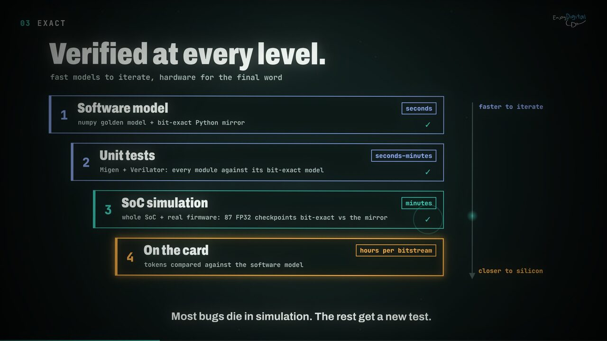

# Getting started

Everything from an empty machine to a chatting card: requirements, the simulation, bitstreams,
models, running on a card, the lab deploy, the card monitor and the release validation. The
[README](../README.md) has the short version; this is the long one, with all the knobs.

## Requirements

- The LiteX ecosystem (litex, litex-boards, litedram, litepcie, VexiiRiscv), installed with
  [`litex_setup.py`](https://github.com/enjoy-digital/litex/wiki/Installation)
  (`./litex_setup.py --init --install --config=full`), October 2026 or later.
- Vivado **2024.1** for the bitstreams (the 2025.2 install lacks the VU33P).
- Verilator >= 5.0 and a RISC-V GCC for the simulation and the firmware.
- Python 3.10+, then from the repository root:

```sh
pip install -e .[dev]             # the `trixium` CLI and the test dependencies
```

## Simulate

The whole SoC - CPU, firmware, TriXium core, memory controllers - runs in Verilator on a tiny
model with the 27B's structure ([`simulation.md`](simulation.md)):

[](images/video-exact.jpg)

```sh
trixium models --tiny                  # the tiny random models the tests and simulation use
./trixium_sim.py --build               # headers + libraries, firmware, Verilog ~1 min, Verilator ~2.5 min
./trixium_sim.py --run                 # boot it: the trixium> prompt after ~267 s (console on stdin/stdout)
./trixium_sim.py --firmware            # after a firmware change: rebuild and re-bake, ~17 s
./trixium_sim.py --gate                # a traced generation compared with the Python mirror, ~10 min
python3 -m pytest -n auto              # tests, fast tier, ~47 s
python3 test/run_guarded.py --runslow  # tests, full tier, ~10 min
```

`--board fk33 --image models/tiny/bonsai-tiny-n8.img` builds the FK33's memory system (HBM
channel models, no scratchpad units); `--board ypcb` the YPCB-00338's (two DDR3 controllers at
the board's timings and clock ratio, four channels, the tiny 4-channel model).

## Build and load

```sh
./trixium_xcu1525.py --build      # -> build/xcu1525/ (+ build/xcu1525.verdict: the timing gate)
./trixium_xcu1525.py --load       # openFPGALoader (JTAG)
./trixium_fk33.py --build         # -> build/fk33/
./trixium_fk33.py --load          # OpenOCD (openFPGALoader does not configure the FK33)
./trixium_ypcb.py --build         # -> build/ypcb/
./trixium_ypcb.py --load          # openFPGALoader (Digilent HS2 cable)
./trixium_ypcb.py --hybrid --engine-channels 4 --ddr-clk-freq 116.6667e6 --sys-clk-freq 100e6 \
    --ddr-quiet-regions both --pipe-clk-freq 133.333e6 --ddr-readers \
    --build --output-dir build/ypcb_hybrid    # the Bonsai 2 2B / 4B build (pipes at 133 MHz, readers in the DDR clock)
```

The defaults are the configurations of the results above; `--help` lists the few knobs
(`--sys-clk-freq`, `--engine-channels`, `--ddr-clk-freq`) next to LiteX's. The XCU1525's
DDR4-1500 needs a host-side training LiteX's BIOS does not do (`software/host/rdlevel.py`); the
FK33 is passively cooled with a marginal HBM regulator: put a fan on it before power-on.
Board details, the timing gate and the operating rules: [`boards.md`](boards.md).

## Models

```sh
trixium models                                       # the 1.7B and 8B GGUFs + tokenizers -> models/
trixium convert models/1.7b/Ternary-Bonsai-1.7B-PQ2_0.gguf    # -> models/bons/bonsai-1p7b-n16.img
trixium convert models/8b/Ternary-Bonsai-8B-PQ2_0.gguf        # -> models/bons/bonsai-8b-n16.img
trixium convert --board ypcb models/1.7b/Ternary-Bonsai-1.7B-PQ2_0.gguf  # -> ...-n8-ypcb.img (5-trit codes)
trixium convert --board ypcb --channels 4 models/2b/Ternary-Bonsai-2-2B-PTQ1_0.gguf  # -> bonsai2-2b-n4-ypcb.img (./trixium_ypcb.py --hybrid)
trixium convert --board ypcb --channels 4 models/4b/Ternary-Bonsai-2-4B-PTQ1_0.gguf  # -> bonsai2-4b-n4-ypcb.img (same build; trixium deploy --board ypcb --model 2b|4b)
trixium tokenizer models/1.7b/tokenizer.json                  # -> models/1.7b/tokenizer.bin
trixium verify models/bons/bonsai-1p7b-n16.img
```

The converter does not requantize: the GGUF's ternary codes (PrismML `PQ2_0` / `PTQ1_0`) and
fp16 group scales are copied bit for bit, repacked into 32-byte beats and sharded across the
memory channels, with a few precomputed tables (RoPE, int16 norm weights, a pre-decoded
embedding). Format: [`model/layout.py`](../model/layout.py). The XCU1525's 8B and 27B images use
its own channel windows ([`boards.md`](boards.md#memory-layout)).

## Run on the card

On the machine with the card, against the build whose bitstream is loaded (the generated
headers differ per build):

```sh
make -C firmware BUILD_DIR=../build/xcu1525                   # -> firmware/trixium.bin
make -C build/xcu1525/driver/kernel                           # trixium.ko + liteuart.ko (generated driver)
trixium driver load                                           # /dev/trixium0, console /dev/ttyLXU0
make -C software/user BUILD_DIR=../../build/xcu1525           # trixium_load, trixium_chat, trixium_smi
```

```sh
sudo software/user/trixium_load models/bons/bonsai-1p7b-n16.img
sudo software/user/trixium_chat -k firmware/trixium.bin
you> What is the capital of France? Answer in one sentence.
bot> The capital of France is Paris.
```

`trixium_chat` applies the chat template, keeps the conversation and its KV cache on the
card (a turn only forwards its new tokens), decodes greedily by default (the mirror's arithmetic) or with
`-S temperature,top_p,repetition`. Also `trixium chat` (Python, `--remote --board <name>` on a
lab board over ssh), `trixium console "stats" "bench 64"` for raw firmware commands, and
`software.client.TriXium` from Python.

## Deploy to a lab board

From the workstation, one command runs the whole sequence on a board host over ssh: timing
gate, firmware and headers, driver and host tools built on the host, configure + warm reboot,
boot (with the DDR4 training on the XCU1525), weights, tokens against the reference, bench:

```sh
trixium deploy --board xcu1525 --model 27b                    # build/xcu1525 on the XCU1525 host
trixium deploy --board xcu1525 --model 8b --no-reconfigure    # next model, board already deployed
trixium deploy --board fk33 --model 1p7b                      # build/fk33 on the FK33 host
trixium deploy --board ypcb --model 8b                        # build/ypcb on the YPCB-00338 host
trixium deploy ypcb_hybrid --board ypcb --model 2b            # the hybrid build, Ternary-Bonsai-2 2B
trixium deploy --board xcu1525 --model 27b --dry-run          # print every command, run nothing
```

The board hosts come from `~/.config/trixium/boards.ini` (format:
[`boards.ini.example`](boards.ini.example); ssh key required). A deploy reboots the
board host: run it detached ([`boards.md`](boards.md#operating-a-card)).

## Card status

`trixium_smi` (like `nvidia-smi`; also `trixium smi`) shows each card's state, sampled from
the core's counters, and keeps LitePCIe's diagnostics as commands:

```sh
trixium_smi                       # status: bitstream, link, clock, utilization, memory, model
trixium_smi -l 1                  # refresh every second
trixium_smi -j                    # the same as JSON
trixium_smi info                  # FPGA identifier, DNA, temperature
trixium_smi scratch_test          # register access
trixium_smi dma_test              # PCIe DMA loopback
```

```
trixium_smi                                                     Thu Oct 15 17:00:05 2026
╭─ Card 0 · /dev/trixium0 · 0000:01:00.0 ──────────────────────────────────────────────╮
│ Bitstream   TriXium on YPCB-00338-1P1 2026-10-15 15:15:32                            │
│ Link        PCIe Gen2 x8              sys 125.0 MHz (measured)                       │
│ State       CPU running               engine streaming          no errors            │
├─ Utilization over 1000 ms ───────────────────────────────────────────────────────────┤
│ Engine  ████████░░  81%     Units   ███░░░░░░░  27%     Overlap  15%                 │
│ 43455 engine ops/s · 3732 served from prefetch/s                                     │
├─ Memory · DDR3-1066 · 8 channels ────────────────────────────────────────────────────┤
│ Read    ████████░░  13.94 GB/s of 17.1 GB/s DRAM peak   request wait   0%            │
│  0 ██░░ 44%   1 ██░░ 44%   2 ██░░ 44%   3 ██░░ 44%   4 ██░░ 44%   5 ██░░ 44%         │
│  6 ██░░ 44%   7 ██░░ 43%                                                             │
├─ Model ──────────────────────────────────────────────────────────────────────────────┤
│ Weights     bonsai-1p7b-n8-ypcb.img  0.94 GiB, uploaded 112 s ago                    │
│ Process     pid 7915 trixium_chat · Ternary-Bonsai 1.7B  generating, 248 tokens      │
│ Decode      █████████░  34.84 tok/s   first token 0.56 s                             │
╰──────────────────────────────────────────────────────────────────────────────────────╯
```

A real sample: the YPCB-00338 decoding Ternary-Bonsai 1.7B in `trixium_chat` (2026-10-15),
the weights streaming at 13.9 of the DDR3's 17.1 GB/s while the engine runs 81 % of the time.
Utilization and GB/s come from the core's counters over `-i` (default 250 ms): engine and
vector-unit busy cycles, beats per memory channel, and the share of cycles the memory did not
take read requests. Weights and Process come from what `trixium_load`, `trixium_chat` and
`software.client` record in `/tmp/trixium/`.

## Release validation

```sh
trixium validate                    # everything, hours: logs + summary in build/validate/
trixium validate --steps sim,tests  # a subset of: build-xcu1525, build-fk33, build-ypcb, tests, sim, board, board-fk33
```

Both bitstreams, the guarded test suite, the simulation gate and the FK33 simulation build,
then both boards with every model.
Run it detached ([`simulation.md`](simulation.md#release-validation)).
