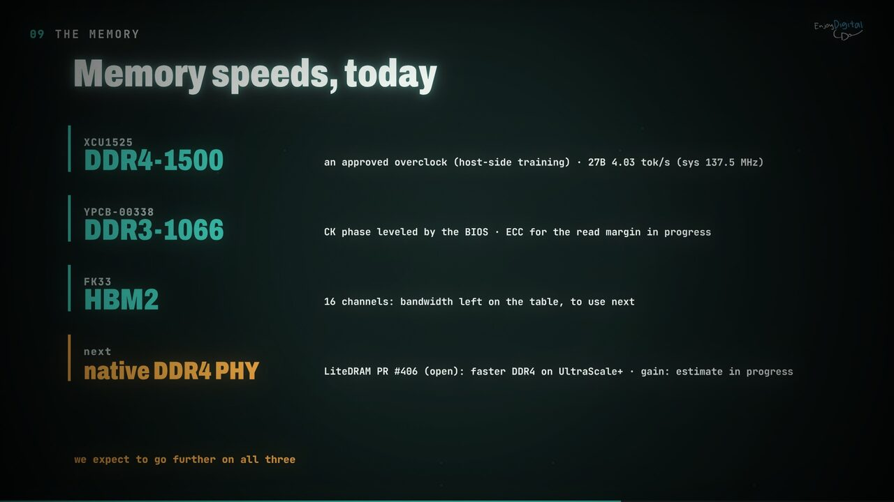

# Performance: next steps

Parked during the release cleanup (2026-10-08). The 27B decode on the XCU1525 is at
**32.2 M cycles/token, 3.88 tok/s** (v30b, sys 125 MHz, DDR4-1500) and **4.03 tok/s** (v31b,
sys 137.5 MHz). The weight streams are DDR-bound: the +10 % sys clock of v31b gave +3.8 %
([`timeline.md`](timeline.md)).

Per-forward profile (v30b): fproj (FFN gate/up) 9.36 M, fdown (FFN down) 6.04 M, DeltaNet
10.7 M, attention 2.72 M, logits 0.87 M. About 21 M of the token is the shared weight stream
(W); about 10.5 M is per-token work (P) that does not scale with the DDR rate.

The per-token work of 2026-10-11 (firmware, measured in the board-timing simulation) is in the
first two sections, with the gateware it points to; then, in order of expected gain:

## Qwen3 path (1.7B / 8B): per-token work

Measured in the board-timing simulation (1.7B and 8B slices, XCU1525, 125 MHz), 2026-10-11:

| model | per layer before | after | predicted token | tok/s |
| --- | ---: | ---: | ---: | ---: |
| 1.7B | 75,645 | 70,752 (-6.5 %) | 2.37 M -> 2.23 M | 52.7 -> 56.0 |
| 8B | 218,320 | 210,977 (-3.4 %) | 8.34 M -> 8.07 M | 14.99 -> 15.48 |

Done, all byte-identical (the Qwen3 gate below, interpreter and RTL tests for the programs):
- the residual tail in one program (`prog_resid_rmsnorm_q8`): norm_i32 + resid_add + the next
  rmsnorm_q8, one dispatch instead of three (twice a layer, and the final norm);
- the FFN up norm inside the multiply (`prog_norm_mul_q8`): one pass and one descriptor less on
  the serial stretch between the up and down streams;
- the norm rows prefetched where the engine is idle (the FFN norm under the scale8 work, the next
  layer's norm as a NOWAIT fetch inside the FFN list), the FFN list's per-layer words rebuilt
  under the output projection's stream, the KV pack bookkeeping in one loop.

What is left (1.7B, per layer, of ~70.8k: W ~38.9k engine busy, P ~32k):

| part | cycles | why it is serial |
| --- | ---: | --- |
| the two residual tails (fused) | ~7.8k | vector work on the critical path: the next matvec needs its x8 |
| FFN tail (norm_mul_q8, quant8 pass) | ~4.5k | between up and down: down needs the quantized product |
| q chain (qkr list: rmsnorm_h, rope_h, quant8) + CPU KV prep | ~4.7k | vector-bound: the attention block's vector work (~7.4k) exceeds its k/v streams |
| attention list + fold (short context) | ~3.5k | the per-head CPU fold, slower than the list at a few positions |
| scale8 (Mh + list) | ~2.4k | needs every head's fold (one common exponent) |
| qkv list tail, list boundaries, CPU | ~5k | |

Why "overlap" stops here: a decode layer is one dependency chain, and every step that feeds a
matvec ends in a global reduction (the absmax of norm_i32's k, rmsnorm's sum of squares,
quant8's shift): nothing of layer l+1 or of the next matvec can start before it. The vector unit
(1 instruction/cycle) is the limit of most of what is left; the rest is CPU time between lists.
Firmware levers left are small (reordering q/k/v in the qkv list is estimated at under 0.5k from the trace; an
in-list V scale writer measured -133 cycles and was not kept). The next real gains are
gateware: vector-unit throughput (two lanes of issue, or wider beats) on the residual tail, the
FFN tail and the attention chains; a 2-deep engine queue only helps where a stream has vector
work of its own to hide, which this chain mostly does not have.

### On the YPCB-00338 (2026-10-15)

The card ran the 1.7B at 32.1 and the 8B at 7.83 tok/s (eight channels, 5-trit codes,
[`boards.md`](boards.md)). The YPCB simulation now builds the target's CPU and predicts the
1.7B within 1.2 % of the card (`trixium_sim.py --board ypcb --bench`, 1.7B slice); its token
trace (`--tprof`, [`software/lab/tprof.py`](../software/lab/tprof.py)) charges every
engine-idle cycle to a firmware op and a list. Per layer (~117k cycles): the weight streams at
~91 % of the DDR3 peak while the engine runs, and ~31k engine-idle cycles:

| part | engine idle per layer | |
| --- | ---: | --- |
| the two residual tails | ~8.4k | 3 passes of 2,048 lanes on the vector unit |
| FFN tail (`norm_mul_q8`, list descriptor 7) | ~6.0k | between the up and down streams |
| attention: q/k chain, list, fold tail, scale8 | ~10k | the fold ~350 CPU cycles per head |
| CPU between ops and lists | ~5k | |

Upper bounds measured by removing each part (tokens no longer valid, cycles only): the
attention fold 0.6 %, the scale8 list 1.4 %, the per-op profiling calls 1.2 % of the token. One
status read per backlog of folds instead of one per head: no change. The firmware headroom on
this chain is ~2-3 %; the same conclusion as the XCU1525's above.

The CPU and its bus are not the limit either (2026-10-15, same simulation). Measured with the
`mmio` console command: a TriXium CSR access costs 16-17 cycles, a scratchpad word 18-21
(writes included: VexiiRiscv waits for each write's response), a cached main_ram read ~6. With
the trace's both-busy counter, neither unit is busy for ~7-9 % of a layer (CPU glue between ops,
the fold tail, the scale8 multipliers, list setup). Tried in the simulation and not kept:
- posted CPU writes (an AXI-Lite write buffer on VexiiRiscv's peripheral bus) plus LiteX's
  low-latency AXI-Lite bridge: -0.2 % of the token;
- the 16 scale8 descriptors as one program (multipliers summed from the p8 spill beats):
  unchanged - the sequencer's dispatch was already cheap, the program's vector time is the cost.
A bigger VexiiRiscv would only shave the CPU's share of that ~8 %.

Both gateware levers are now in (2026-10-15; on the card: 1.7B 32.1 -> **35.2 tok/s**, 8B
7.83 -> **8.11 tok/s**, `build/ypcb_pff2`, prefetch 0 mismatches, [`boards.md`](boards.md)):
- **weight prefetch** (engine op 7): the firmware issues a matvec's reads ahead and the matvec
  starts on the beats buffered in the readers' FIFOs (2048 beats, 64 KB per channel: +96
  RAMB36). Four gaps per layer: down's weights ahead of norm_mul_q8 (in the FFN list), the
  gate's and the next qkv list's first projection under the residual tails, WO under the scale8
  list. 1.7B slice: 117.6k -> 108.0k cycles per layer (-8.2 %); with today's 512-beat FIFOs
  -1.7 %. The 8B gains less: its gaps are longer than the FIFO's reach.
- **fused vector instructions** (VADDC16, VSHLVC16, VSHLSC16, VQ8V; `asm.fuse()`): the
  residual tail 26 -> 22 and the FFN tail 15 -> 12 instructions per 16 lanes; with the prefetch
  105.6k cycles per layer (-10.2 % in all): the 1.7B predicted at 34.6 tok/s (31.7 before),
  35.2 measured.
Both are bit-exact (mirror gate: 64/64 checksums). Next on this path: deeper reader FIFOs
where BRAM allows, vector-unit dual issue.

## 27B path: per-token work

Measured in the board-timing simulation (27B slice, XCU1525, 125 MHz), 2026-10-11; the same
tokens as before on the slice, the hybrid gate 87/87:

| step | predicted token | tok/s |
| --- | ---: | ---: |
| before (main, as measured on v30b: 32.2 M) | 32.70 M | 3.82 |
| lists posted: the CPU builds the next list while the current one runs | 30.28 M | 4.13 |
| conv taps under the previous chunk's conv, embedding row 32 bits at a time | 30.01 M | 4.17 |

Done, all firmware:
- **Posted lists** (`rl_post`, `resident_join`, two descriptor banks in `resident.c`). Building a
  list cost ~430 cycles per descriptor (C builders and cache misses on main RAM, ~190 cycles
  each; the scratchpad stores themselves are cheap): ~58k cycles per DeltaNet + FFN layer,
  ~12 % of the token, all with the DDR idle. The residual stream, `resident_prepare` and the
  out/down projections now leave their list in flight while the CPU builds the next one; the
  conv list is built while the projections stream, the q/k L2 list while the conv runs, the
  attention values list while the scores run. Untraced, the mixer and FFN outputs stay in RS_F
  for the residual add (no store, no cache maintenance), and the residual add closing a layer
  runs the next layer's attention norm in the same list.
- **Conv taps double-buffered**: chunk c+1's taps are a NOWAIT fetch under unit 13's chunk c
  (OVERLAP): 25.6k -> 21.5k cycles per DeltaNet layer.
- **Embedding row** read from the scratchpad a 32-bit word at a time: 192k -> 125k per token.

Tried and not kept: a restore overlapped with the next projection's stream (FFN gate/up,
DeltaNet qkv/z, attention q/k), and a diff-writing descriptor cache. The restore unit's
scratchpad reads outrank the engine's x reads, so the stream slowed by what the restore hid
(no gain); the descriptor cache's main-RAM copies cost more misses than the stores they saved.

With posted lists the hybprof phases blur (a list is charged to the phase that joins it: the
FFN down projection now shows up in `resid`); compare per-layer totals, not phases.

What is left (27B slice, per layer, cycles; weights at the DDR peak in brackets):

| part | cycles | why it is serial |
| --- | ---: | --- |
| DeltaNet projections list | 72.4k (60.1k) | two prepares of the 5120-wide input, restores, small beta/alpha streams |
| DeltaNet conv + SiLU | 21.5k | unit 13 at ~1 channel/clock, window fetches between chunks |
| DeltaNet heads (op 5) | 51.6k (state 16.4k) | 16 lanes at one state element per lane per clock: compute-bound |
| DeltaNet q/k L2, gated norm, out prepare | ~17k | vector/unit chain; the out projection needs it |
| FFN gate/up list | 142.1k (124.8k) | two restores (4.4k) and the SiLU (4.9k) between the streams |
| FFN down prepare (17408 wide) | 16.9k | units 4/3/5 at ~1 element/clock, a whole-vector exponent first |
| FFN down projection | 77.5k (62.2k) | two K-segments and their int32 sum (2.6k) |
| attention layer | 145.4k (73.2k) | q/k/v list, scores, CPU softmax (12.8k), values, out prepare |

Why the firmware stops here: every remaining serial step is either a unit chain whose output
the next stream needs (a prepare ends in a whole-vector exponent, a norm in a sum of squares),
a unit that slows the stream it would hide under (the scratchpad read port), or the DeltaNet
stream's own compute. The next gains are gateware, in order of expected gain per area:

| gateware change | saves (27B token) | note |
| --- | ---: | --- |
| prepare units (4/3/5) at 4 elements/clock | ~1.8 M (6 %) | 2.4 M elements prepared per token at ~1/clock today |
| DeltaNet stream at 2 elements per lane per clock | ~1.2 M (4 %) | heads 51.6k -> ~26k per layer (the state stream floor is 16.4k) |
| engine x vector off the shared scratchpad read port | ~0.7 M (2.4 %) | restores and SiLU could then hide under the streams (measured: no gain today) |
| down projection's K-segments streamed back to back | ~0.7 M (2.3 %) | 77.5k vs ~66k at the gate/up streams' 94 % |
| conv unit at 2 channels/clock | ~0.3 M (1 %) | |

Together ~4.7 M: ~25.3 M cycles/token, ~4.9 tok/s at 125 MHz. The VU9P sits near its ~585k-LUT
congestion limit (v20/v21), so each needs an out-of-context timing check first; the x-vector
port and the prepare units are the cheapest.

### Gateware, first two levers (board-timing sim, 27B slice)

| step | predicted token | tok/s | core logic LUTs (VU9P OOC) |
| --- | ---: | ---: | ---: |
| firmware above | 30.01 M | 4.17 | 455.8k |
| prepare units: Hadamard input streamed, activation quantizer ping-pong (kept) | 29.67 M | 4.21 | +7.4k, +4 BRAM tiles |
| + engine read port and the pair overlap (dropped) | 29.48 M | 4.24 | +12.0k, +64 BRAM tiles more |

- **The prepare units were not at ~1 element/clock each**: unit 4 is 8 FP32 lanes per beat,
  unit 3 32 butterfly lanes; the chain's ~0.8 clock per element was its serial scratchpad
  passes. Measured per 1,024-element block: unit 4 262 clocks (two passes), unit 3 412 (three
  clocks per input word), unit 5 ~135. Now unit 4 ~137 (ping-pong buffer, one pass) and unit 3
  347 (streamed input): the 17-block (17,408-wide) rotated prepare 14,024 -> 10,807 cycles.
- **Engine read port, tried and dropped**: a scratchpad replica only the engine reads, so the
  second projection of a pair (FFN up/gate, DeltaNet qkv/z, attention q/k) streams under the
  first one's restore. Only one restore per pair hides (the second one and the SiLU feed the
  next prepare, which needs their whole output): -0.19 M per token for 12k LUTs and 64 BRAM
  tiles on a VU9P near its congestion limit. Branch `gw-xport-prepare` keeps it.
- **What is left in the prepare**: unit 3's ten butterfly stages (170 clocks) and its 128
  int32 output beats run one after the other, then unit 5 rereads everything (128) for the
  whole-vector exponent. A fused, block-pipelined quantize -> Hadamard (scan, rotate and write
  of three different blocks at once on the two ports) would bound a block at ~170 clocks, the
  whole rotated prepare (with unit 5's pass) at ~0.3 clock/element against ~0.6 now: ~0.7 M
  per 27B token more.

## Denser ternary codes (5 trits per byte): the YPCB's default since 2026-10-15

Adopted for the YPCB-00338 (eight channels, `--trit5` by default: 32.1 / 7.83 tok/s on the card
against 27.0 / 6.44 with four channels and 2-bit codes); the XCU1525 and FK33 keep 2-bit codes. A
trit is stored in 2 bits (a code beat: 128 trits in 32
bytes, plus a 32-byte beat of fp16 scales per 2,048 columns). Base 3 stores 5 trits per byte
(3^5 = 243 <= 256): 128 trits in 26 bytes, lossless. A 2,048-column row goes from 17 to 14 beats
(-17.6 %), 1.725 bits per weight against 2.125.

**The prototype** (branch `trit5`: the unit and engine tests, the YPCB SoC simulation's system
test, and the hybrid gate on a packed tiny-hybrid image, 87/87 checksums and the token, pass):
- `KIND_TERNARY5` (model/layout.py): `row_beats` counts memory beats, `code_beats` pipe beats;
  rows padded to a whole beat (none at the Qwen3 widths); `convert`/`tinygen --trit5` pack the
  streamed projections (Qwen3 and the 27B's DeltaNet ones), a separate LM head, and the token
  embedding when the int16 table is in the image (the CPU decoders refuse packed rows).
- `Trit5Unpacker` per channel in front of the pipe (`with_trit5`, trixium_ypcb.py `--trit5`):
  a 26-byte window over buffered memory beats, 26 base-3 decode tables, one 2-bit pipe beat per
  clock. Out of context on the K480T: 1,215 LUTs, 1,320 FFs, 13 RAMB18 per channel, +4.8 ns of
  slack at 125 MHz.
- the engine op's `pk` bit (CSR, descriptor w6[4]), set by the firmware from the entry's kind.

**Measured (YPCB SoC simulation, 1.7B slice, the board's DDR3-1066 and 125 MHz):**

| engine channels | codes | cycles per layer | predicted 1.7B |
| --- | --- | ---: | ---: |
| 4 (the shipping build) | 2-bit | 144,201 | 26.5 tok/s |
| 4 | 5-trit | 144,048 | 26.6 tok/s |
| 8 | 2-bit | 140,880 | 27.2 tok/s |
| 8 | 5-trit | **123,088** | **30.5 tok/s** |

With four channels the stream is bound by the pipes (one beat per clock each; DDR3-1066 can feed
~1.07 per channel at 125 MHz): fewer bytes change nothing. With eight channels the DDR3 is the
bound, and 5-trit codes give 12.6 % per layer. The tied LM head was still 2-bit in these runs
(about 16 % of the 1.7B token streams it): packed too now, worth ~2 % more.

**The 8-channel `--trit5` YPCB build** (`--engine-channels 8 --chan-stride 0x20000000`) fits:
207.3k LUTs (69 %), 773 BRAM tiles (81 %), 541 DSPs, against 131.8k / 490 / 324 for the 4-channel
build. Timing misses by 0.59 ns (3,982 endpoints), none in the unpackers:
- ddr domain (7.5 ns): the engine ports' read-modify-write path (`LiteDRAMAXI2Native`, write
  strobes through `w_partial` to the CDC FIFO address, 17 logic levels; eight copies now) and
  the ddr reset fan-out;
- sys (8 ns): the vector unit fed from the engine's absmax (the paths already marginal on the
  first card build).
Closing it needs a register in the RMW request path (or no RMW on full-strobe engine ports) and
the vector-unit paths pipelined, both independent of the packing.

Still open: the XCU1525 (DDR4-bound streams, ~0.67 beats per channel per clock) on the 27B slice
(the packed slice image is generated; its board-timing sim build needs ~6 GB of disk, not run);
the 8B needs a window layout for 8 channels (the first window per controller is 192 MB at a
512 MB stride).

## 1. DDR read efficiency

The 27B token is 2.34x the 1-beat/channel/clock floor (13.5 M). Look at:
- gaps between lists (list setup, the first-beat latency per K-segment);
- the controllers' bank/page behaviour on the striped weight layout (refresh, row switches);
- the up-converter and AXI crossing efficiency at the 187.5 MHz controller clock.

Measure in the board-timing Verilator simulation first ([`simulation.md`](simulation.md): its
per-layer cycles are within a few percent of v30b's), then on the board with `bench` and the
per-phase profile.

A higher DDR rate is not a clock setting: the USPDDRPHY's ISERDES is in spec up to DDR4-1250
on this part and DDR4-1500 is already an approved overclock (DDR4-1600 does not train,
[`boards.md`](boards.md)). More raw bandwidth needs a native-mode PHY.

## 2. Controller 1 errors at sys 137.5 MHz

v31b: DDRTEST shows ~160 errors per channel on controller 1 after training (v30b: 1-2). The
trainer reports clean lanes, so the failure is past the DQ eye: likely the controller's own
timing (its failing endpoints) or the crossing. Tokens are still exact, but this has to be
clean before shipping 137.5 MHz. Start from the failing-endpoint list of v31b, grouped by
controller.

## 3. Speculative decoding (MTP), revisited after the gateware above and 1-2

Exact on the board, 60-64 % of the drafts accepted at k=1/2, but a net loss today: 0.72x with
sequential verification, about 1.05x projected with everything batched over two lane sets
([`method.md`](method.md#lessons-from-the-climb)). The
implementation (MTP head, versioned DeltaNet state, batched matvec `nbatch`) was removed in the
release cleanup; it is in git history at commit `48acf64`. It becomes worth it once P and the
head cost shrink.
