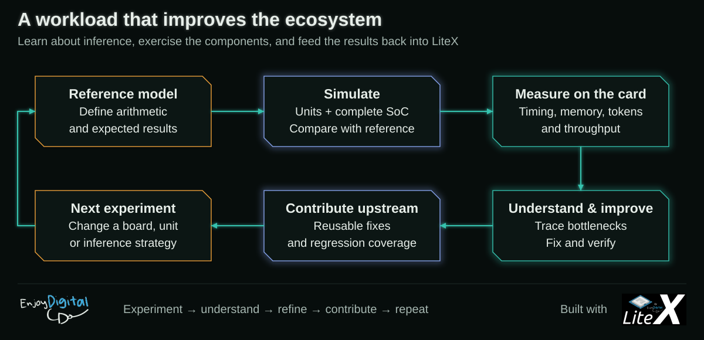

# Simulation and tests



Development happens in simulation: Python models and Migen/Verilator unit tests for each
module, the whole SoC in Verilator for the firmware, the Python mirror as the oracle. The
board is only needed for what simulation cannot answer: timing closure, the board self-test,
DDR4/HBM behaviour and the real speed of the real models.

## Test suite

```sh
pip install -e .[dev]           # the trixium package, its CLI and the test dependencies
trixium models --tiny           # tiny random models under models/tiny/ (seconds)
python3 -m pytest -n auto                      # fast tier, ~47 s (cold tree: + the Verilator builds)
python3 -m pytest -n auto test/gateware/units  # one directory, or one file
python3 test/run_guarded.py --runslow          # full tier, ~10 min, in parallel under a memory guard
python3 -m pytest test/system/test_sim_smoke.py --runslow   # one slow test (built simulation)
```

Two tiers. Plain `pytest` is the fast tier; `--runslow` adds the tests marked `slow`: the
Migen cross-checks (a representative test per file, `backend=migen`: the same checks on
Migen's own semantics, up to a few minutes each, ~9.5 GB for the LiteDRAM controller one)
and the tests that need a built SoC simulation or a converted 1.7B image.

Every simulation longer than a few seconds runs compiled:
[`test/common/verilator.py`](../test/common/verilator.py) converts a Migen module to
Verilog and builds it with Verilator into `build/verilator/<top>-<hash>/`, reused until the
Verilog, the C++ or the flags change (a cold tree spends a few minutes compiling, in
parallel). A `key` naming the construction skips even the conversion on a hit. Its C++ side
(`test/common/rtl/`) provides an AXI4 slave memory (latency, random stalls on every
channel, ID reordering, a read freeze), the resident scratchpad client port, a script
driver and a co-simulation library. Three ways in:

- `Script` (set / wait / handshake / peek / read), run unchanged on the compiled design or
  on Migen's simulator: the engine, sequencer, scratchpad-overlap
  (`common.engine.EngineBench`) and vector-unit tests.
- `run(dut, generators, backend)` / `Compiled`: Migen testbench generators, unchanged, on
  the compiled DUT (a shared library driven through ctypes, `run_simulation`'s semantics:
  reads before the edge, writes committed with it). `ChannelModel` stands in for an
  `HBMChannelModel` (same arguments; `mem`, `freeze` and `init` map onto a C++ AXI slave).
  The unit, AXI, DDR4 port path (LiteDRAM's controller and PHY model compiled) and reset
  tests use it; `common.cluster.run` does the same for the whole core (`SoC(config,
  backend=...)`).
- A hand-written C++ `driver` (`test/common/rtl/*.cpp`, `common.rtl_client`) for the
  arithmetic-heavy units' million-element sweeps.

Waveforms are off by default (a tracing build is a slower model). `pytest --waves` (pytest
already owns `--trace`) or `TRIXIUM_TRACE=1` builds with `--trace-fst`, cached apart, and
dumps one file per run into `build/traces/<test id>/`: an FST from the compiled Script,
`rtl_client` and co-simulation runs, a VCD from Migen runs through `run_migen` / `run`.
Hand-written harnesses in `test/common/rtl/*.cpp` and direct `run_simulation` calls never
trace.

`test/` mirrors the source tree, one test file per source module:

```
test/gateware/core/     test_engine.py test_sequencer.py test_scratchpad.py test_vector.py
                        test_pipe.py test_reset.py
test/gateware/units/    test_activation.py test_hadamard.py test_restore.py test_silu.py
                        test_norm.py test_conv.py test_fp32.py test_deltanet_stream.py
                        test_attention_stream.py
test/gateware/memory/   test_axi.py test_ddr.py test_loader.py
test/gateware/          test_targets.py (the targets' CRG and shared core construction)
test/model/             test_asm.py test_bitexact.py test_bons.py test_layout.py test_golden.py
                        test_qformats.py test_gguf_reader.py test_rv32_math.py test_silu_hw.py
test/firmware/          test_hybrid.py test_perf.py test_memory.py test_sequence_lib.py
test/software/          test_timing.py test_mirror.py test_benchmark.py
test/system/            whole core / whole SoC: test_integration.py test_units.py test_sim_smoke.py
test/common/            shared testbench pieces: verilator.py (compiled simulation), engine.py,
                        rtl_client.py, cluster.py, the C oracles, rtl/ (Verilator models and
                        harnesses), data/ (archived traces, logs)
```

What the suite covers:

- **Modules against Python models**: every unit (`test/gateware/units/`), the engine,
  sequencer, scratchpad arbitration and channel pipes (`test/gateware/core/`), the vector
  unit, the AXI paths and the DDR4 port path on the real LiteDRAM core
  (`test/gateware/memory/test_ddr.py`). The arithmetic-heavy units also run as compiled
  Verilator testbenches (`test/common/rtl/*.cpp`).
- **Encoders and formats**: the descriptor encoders, C against Python
  (`test/firmware/test_sequence_lib.py`), the GGUF reader, the BONS converter and layout
  contract (`test/model/`).
- **The mirror**: `test/firmware/test_hybrid.py` checks the Python mirror of the firmware
  (`model/mirror.py`) against the golden model; `test/gateware/units/test_fp32.py` / `test/model/test_rv32_math.py`
  pin the FP32 and RV32 math.

[`test/run_guarded.py`](../test/run_guarded.py) runs the suite on a machine shared with
Vivado: one pytest process per file (per test for `test/gateware/memory/test_ddr.py`, whose
Migen controller case peaks ~9.5 GB, and for files the last run measured above
`--split-above` seconds), up to `-j` at once (default: half the cores), longest first. A unit starts only when its peak RSS from the
previous run (`build/tests/record.json`; `--min-free` GB when unknown) plus `--margin` GB is
available and the running units' peaks stay under `--max-gb`; a watchdog stops the newest
unit when the host drops below `--kill-free` GB and retries it alone at the end. Arguments
after `--` go to pytest. Exit 0 only when every unit passed.

## SoC simulation

`trixium_sim.py` builds the same SoC as a board - VexiiRiscv with the FPU, the
firmware, the TriXium core, the memory controllers - on LiteDRAM's DDR4 PHY model (or HBM
channel models), and runs it in Verilator on a tiny model with the 27B's structure
(`models/tiny/bonsai-tiny-hybrid-1k-n8.img`: DeltaNet and attention layers, rotation widths
that are multiples of the hardware's 1,024-element Hadamard block).

```sh
./trixium_sim.py --build        # headers + libraries, firmware, Verilog (~1 min), Verilator (~2.5 min)
./trixium_sim.py --run          # boot it: the trixium> prompt after ~267 s (console on stdin/stdout)
./trixium_sim.py --firmware     # rebuild the firmware and re-bake it into the built sim (~17 s)
./trixium_sim.py --gate         # traced generation against the Python mirror (~10 min)
./trixium_sim.py --bench        # resident path off/on, cycles per forward
```

| option | default | |
| --- | --- | --- |
| `--board` | `xcu1525` | `fk33`: HBM channel models, no scratchpad units (with `--image models/tiny/bonsai-tiny-n8.img`) |
| `--image` | `models/tiny/bonsai-tiny-hybrid-1k-n8.img` | BONS image baked into the memory model |
| `--out-dir` | `build/sim_<board>` | build directory (`build/sim_xcu1525_bt_<image>` with `--board-timing`) |
| `--board-timing` | off | the XCU1525 as it runs, for the shape-true slices ([below](#board-timing-simulation)) |

The simulated SoC boots the firmware directly: its ROM is a two-instruction jump to main_ram
(no LiteX BIOS), and the firmware, built against the simulation's headers (`TRIXIUM_SIM`),
skips what only real hardware needs - the DDR4 controller init and DDRTEST (the PHY model has
no training state; `ddrinit`/`ddrtest` still run them), the boot-time zeroing of memory the
models hold zeroed at power-on, the SiLU table readback - and prints `SIMT <phase> <cycle>`
marks of the boot phases. The board builds never define `TRIXIUM_SIM`.

`--run`, `--firmware`, `--gate` and `--bench` take the same `--board`, `--image` and
`--out-dir` as the build. `--firmware` does not regenerate anything: it rebuilds the firmware
(`make -C firmware BUILD_DIR=../build/sim_xcu1525`) and rewrites only the DDR4 model's init
files that hold it (XCU1525 simulation only; the FK33 one needs `--build`). Other options
(`--trace`, `--threads`, `--cpu-type`, HBM model latency and stall rate):
`./trixium_sim.py --help`.

## The simulation gate

`./trixium_sim.py --gate` is the firmware's acceptance test
([`software/lab/simgate.py`](../software/lab/simgate.py)):

1. the Python mirror ([`software/lab/mirror.py`](../software/lab/mirror.py)) runs on the tiny image
   and records the FP32 checkpoints of a generation from the prompt ids `1 2 3`;
2. the built simulation is driven through its console (boot legs skipped, then `dbg 3` and
   `gen 1 1 2 3`) and the firmware prints the same checkpoints;
3. the comparison requires every checkpoint to be bit-identical: the gate passes on
   `87 checksums identical, 0 different`.

On a Qwen3 image the same gate checks the 1.7B/8B path: e.g.
`./trixium_sim.py --board-timing --image models/slices/bonsai-1p7b-slice-n16.img --gate` compares
124 checkpoints over the prompt's three forwards (the mirror's generated-token forward, which the
card's `gen 1` does not run, is dropped; the attention list's raw spill sums `awp8`/`awam`/`scb`
have no mirror counterpart and are not compared). It takes ~45 min: the `dbg` checksums are CPU
reads of the scratchpad, slow in simulated time.

Logs and traces go to `build/sim_<board>/gate/`. After the run the gate prints the firmware's
`stats` profile (cycles per forward). That total is not a fingerprint: it moves by a few
hundred cycles with the firmware's build timestamp and the console timing (e.g. 658,485 to
658,877 cycles per forward on the tiny hybrid model); the checkpoints are what must match.

The same checkpoints are read back from the card on the board (`python3 -m software.lab.mirror
card`, then `compare`), so a numerics difference shows the same way in simulation and on
hardware. Judge a running simulation by its process (`ps`, Vsim CPU time), not by the last line
of its console log: the log is buffered.

### Resets: random power-on values and a mid-op soft reset

Datapath registers carry no reset ([`architecture.md`](architecture.md), "Resets"), and a
plain simulation cannot tell whether one of them needed it: Migen's Verilog starts every
register at its reset value. Two runs make a missing reset visible:

- `./trixium_sim.py --random-init SEED --build` (into `build/sim_<board>_ri<SEED>`) gives every
  clocked register that no reset branch assigns a random power-on value of its width
  ([`software/lab/randinit.py`](../software/lab/randinit.py)). Memories, reset registers, the
  reset generators (the `por` power-on reset, the `resync` synchronizers, `*_rst` nets) and the
  MultiReg synchronizer stages keep their values: their INIT is their function. Then `--gate`
  with the same `--random-init SEED`; it must stay bit-identical.
- `--gate-pre "gen 2 5 6 7;wedge"` runs a generation, then `wedge` (an engine op that cannot
  complete, the stall reporter giving up, the engine soft reset, the self-test), before the
  traced generation: whatever the soft reset leaves in the reset-less registers must not change
  the next generation.

Before the board, speed changes are measured in cycles in simulation:
`./trixium_sim.py --bench` (`--bench-toggle resident|silu|dnstream`, `--bench-tokens 2`) A/Bs
a console toggle on the firmware's own cycle counters (a signal about CPU work removed, not a
board number: the DDR4 model's latency is not the board's). Board numbers come from the
board-timing simulation below.

## Board-timing simulation

The default simulation is built for checking (tiny model, 8 channels, a 2:1 ddr:sys clock, DDR4
timings for 100 MHz, a reshaped DRAM geometry): its cycle counts are not the board's.
`--board-timing` builds the XCU1525 as it runs, for shape-true slices of the real models:

```sh
python3 -m model.tinygen --slice bonsai-27b-slice --channels 16 --out models/slices  # ~15 min (emb16)
./trixium_sim.py --board-timing --image models/slices/bonsai-27b-slice-n16.img --build   # ~7 min
./trixium_sim.py --board-timing --image models/slices/bonsai-27b-slice-n16.img --bench   # ~25 min
python3 -m software.lab.simcal build/sim_xcu1525_bt_bonsai-27b-slice-n16/bench/bench-as-built.log \
    models/slices/bonsai-27b-slice-n16.img                                            # re-report
```

What matches the board (`trixium_sim.py`'s `BOARD_DDR4_MAP`, `board_timing_preset`, checked
against `trixium_xcu1525.py`'s defaults at build time):

- clocks: ddr:sys = 187.5:125 (sim clockers at 1.2 / 0.8 us, 6 evaluations per sys cycle);
  the SoC declares 125 MHz, so the firmware's tok/s are the board's;
- DDR4: the target's MT40A512M8 timings at 187.5 MHz 1:4 (CL 11, tRCD/tRP 4, tREFI 1465 ddr
  cycles), its bank/column map (ROW_BANK_COL, 1024 columns: the 32 KB channel skew is a bank-group
  step as on the board), rows cut to 4096 (512 MB per controller); the PHY model's read latency
  equals the USPDDRPHY's (8 ddr cycles); the controllers, crossbar ports, AXI bridges and AXI
  crossings are the board's code;
- CPU: the target's VexiiRiscv (`VEXII_ARGS`: 32 KB I$/D$, branch prediction, Zbb, FPU);
- core: 16 channels, 16 DeltaNet lanes, the attention stream at (24, 4, 256, 1024);
- memory map: 32 MB main_ram (the slices' CPU tables), 64 MB windows from 64 MB (the firmware
  ends a window at a stride boundary).

The slices (`model/configs.py` `SLICE_OF`, `python3 -m model.tinygen --slice`): random weights at
the real widths and head counts, K-segmented as the converter does, the int16 embedding table
included; `bonsai-27b-slice` is 3 DeltaNet + 1 attention layers with vocab 29440 (one whole
21888-row LM-head chunk plus the 7552-row partial one the 27B also ends with), `bonsai-8b-slice`
(untied head) and `bonsai-1p7b-slice` (tied) are 4 Qwen3 layers with vocab 8192.

`--bench` (`--bench-toggle none`, `bench 2`: three prompt forwards and one decode token) prints the
firmware's profile, then [`software/lab/simcal.py`](../software/lab/simcal.py) normalizes it per
layer and extrapolates the decode token of the full model: hybprof's phases per layer kind x the
model's layer counts (27B: 48 DeltaNet, 16 attention), the LM head per token with its chunk lists
scaled by the vocabulary (the final norm, rotation and argmax are not), the embedding and the
rest of the measured decode token as they are; for Qwen3, the decode token less the head and the
embedding, per layer. It reports the W/P split (W: engine busy, from the overlap counters,
which includes the op 5/6 state and K/V streams; P: the rest), the stream efficiency (weight
bytes over the DDR4 peak of 4 x 64 B per ddr clock = 384 B per sys clock) and the comparison with
the XCU1525 v30b measurements.

First comparison (2026-10-11, firmware as of this commit, per layer / per token at 125 MHz):

| 27B phase | sim | board v30b | error |
| --- | ---: | ---: | ---: |
| DeltaNet layer (dn) | 226,989 | 222,917 (10.7 M / 48) | +1.8 % |
| - in projections + activation | 80,540 | 80,000 | +0.7 % |
| - conv | 39,087 | 38,958 | +0.3 % |
| - heads | 51,404 | 51,458 | -0.1 % |
| - out projection | 36,781 | 36,458 | +0.9 % |
| attention layer | 174,560 | 170,000 (2.72 M / 16) | +2.7 % |
| FFN gate/up per layer (fproj) | 146,419 | 146,250 (9.36 M / 64) | +0.1 % |
| FFN down per layer (fdown) | 94,404 | 94,375 (6.04 M / 64) | +0.0 % |
| LM head per token | 1.285 M | 1.305 M (0.87 M x 6/4 forwards) | -1.5 % |
| decode token | 32.67 M (3.83 tok/s) | 32.2 M (3.88 tok/s) | +1.5 % |

| Qwen3 | sim per layer | board per layer | predicted token | board token | error |
| --- | ---: | ---: | ---: | ---: | ---: |
| 8B (36 layers) | 218,320 | 219,651 | 8.34 M (14.99 tok/s) | 8.39 M (14.9 tok/s) | -0.6 % |
| 1.7B (28 layers) | 75,645 | 73,923 | 2.37 M (52.7 tok/s) | 2.32 M (53.8 tok/s) | +2.1 % |

(The board's Qwen3 per layer is its token less the predicted LM head and embedding: the board
profile has no per-layer split.)

After the Qwen3 per-token work of 2026-10-11 ([`performance-next-steps.md`](performance-next-steps.md)),
same simulation, not yet measured on the board:

| Qwen3 | sim per layer | predicted token |
| --- | ---: | ---: |
| 8B | 210,977 | 8.07 M (15.48 tok/s) |
| 1.7B | 70,752 | 2.23 M (56.0 tok/s) |

After the 27B per-token work of 2026-10-11 (posted lists, the conv taps under the conv, the
embedding read), same simulation, not yet measured on the board: the 27B decode token 32.70 M
-> 30.01 M (3.82 -> 4.17 tok/s), the slice's tokens unchanged. Posted lists are charged to the
phase that waits for them (the FFN down projection shows up in `resid`, the DeltaNet out
projection in the next phase), so the per-phase rows of the comparison above no longer line up
with v30b's; compare whole tokens (the slice's decode token 2.486 M -> 2.255 M).

The DeltaNet in-projection / activation boundary is the one mismatch inside a layer: in
projections +21 %, activation -16 %, their sum +0.7 %. The projection list is posted and its tail
completes inside the activation phase, so where the CPU's timestamp falls splits one stream
differently; compare their sum. The in-projection phase alone reads more weights than the peak
would allow in its time (139 % on the sim, 169 % on the board) for the same reason.

Stream efficiency (weight bytes / (cycles x 384 B)) is the board's: FFN gate/up 85 % on both
(the "~86 %" of the 27B's weight stream), FFN down 66 % on both, the LM-head chunk lists 84 %,
the Qwen3 heads 90 % (8B) and 85 % (1.7B). The predicted 27B decode token splits into W 22.5 M
and P 10.2 M (the board estimate: ~21 M and ~10.5 M; W here counts the op 5/6 streams).

What this simulation does not model: DDR4 electrical behaviour, training and controller errors
(controller 1's at 137.5 MHz), refresh and bank timing beyond LiteDRAM's controller model,
anything that depends on the board's real data (random weights: the rare argmax/SiLU fallbacks
are data-dependent), positions beyond the bench's few (attention at long context). A firmware or
gateware change that moves work between W and P, or overlaps per-token work with the weight
streams, is predicted per layer to a few percent; check the per-layer table, not only the total.
Verilator time per forward: ~3.8 min on the 27B slice (~10k sys cycles/s), ~2.3 min on the 8B
slice, ~0.6 min on the 1.7B slice; boot to the console 8.5 / 4 / 2.5 min; a build ~7 min (up to
~2 GB of DDR4 init files, ~2 GB RSS); a bench 25 / 13 / 5 min.

### The YPCB

`--board ypcb` is board-true by construction: the board's sys/ddr ratio (`--sys-clk-freq`), its
DDR3-1066 timings, 8-bank / 8 KB-row geometry, bank skew and controller settings, the K7DDRPHY's
latencies, the target's CPU (`trixium_ypcb.VEXII_ARGS`). On the 1.7B slice (eight channels,
5-trit codes) it predicts 3.94 M cycles/token = 31.7 tok/s against the card's 32.1 (+1.2 % in
cycles; with the earlier, smaller CPU: +5.5 %):

```sh
python3 -m model.tinygen --slice bonsai-1p7b-slice --channels 8 --trit5 --out models/slices
./trixium_sim.py --board ypcb --image models/slices/bonsai-1p7b-slice-t5-n8.img --out-dir build/sim_ypcb_s --build  # ~15 min
./trixium_sim.py --board ypcb --image models/slices/bonsai-1p7b-slice-t5-n8.img --out-dir build/sim_ypcb_s --bench --bench-toggle none
./trixium_sim.py --board ypcb --image models/slices/bonsai-1p7b-slice-t5-n8.img --out-dir build/sim_ypcb_s --tprof  # idle breakdown
./trixium_sim.py --board ypcb --image models/slices/bonsai-1p7b-slice-t5-n8.img --out-dir build/sim_ypcb_s --firmware  # ~10 s
```

`--firmware` rebuilds the firmware and rewrites controller 0's bank init files in place (DDR4 and
DDR3), so a firmware A/B is a bench away (~7 min on this slice). `--prefetch BEATS` and
`--vec-fused` build the target's weight prefetch and fused vector instructions (the YPCB
target's defaults: 2048, on). `--tprof` traces the second
generated token of a bench and prints its engine-idle cycles per op and per sequencer list, and
the largest idle intervals.

## Release validation

```sh
systemd-run --user -E PATH="$PATH" -E HOME="$HOME" --working-directory=$PWD trixium validate
trixium validate --steps sim,tests      # a subset of: build-xcu1525, build-fk33, tests, sim,
                                        #   board, board-fk33
```

`trixium validate` ([`software/lab/validate.py`](../software/lab/validate.py)) runs everything, for
hours: both bitstreams in parallel, the guarded test suite, the simulation build and gate and
the FK33 simulation build, then the XCU1525 board with the 27B (full deploy), the 8B and the
1.7B, and the FK33 board with the 1.7B and the 8B (hosts from `~/.config/trixium/boards.ini`,
[`boards.md`](boards.md)). Logs go to `build/validate/`, the verdicts to
`build/validate/summary.txt`.
